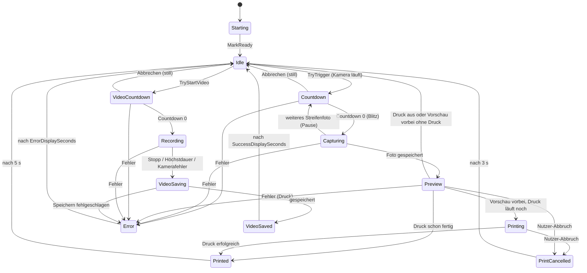

# Architektur

## Schichten

| Schicht | Ort | Regel |
|---|---|---|
| Core | `src/Fotobox/Core` | UI-frei. Zustandsmaschine (`BoothController`), Einstellungsmodelle, Interfaces, reine Rechen- und Entscheidungslogik. Keine direkten Abhängigkeiten auf konkrete Dienste. |
| Services | `src/Fotobox/Services/*` | Konkrete Implementierungen der Interfaces aus `Core/Interfaces.cs` (Kamera, Druck, Speicher, Monitore, Erkennung, Audio, Layout, Foto-Verzierer). |
| ViewModels | `src/Fotobox/ViewModels` | MVVM mit CommunityToolkit.Mvvm. `Booth` = Gastansicht, `Admin` = Einstellungen und PIN. |
| Views | `src/Fotobox/Views` | WPF-Fenster und Controls (`Booth`, `Admin`, `Controls`, `Converters`). |

Alle Abhängigkeiten sind Interfaces in `src/Fotobox/Core/Interfaces.cs`. Dadurch sind Controller und ViewModels mit Fakes testbar.

## Composition Root und Lebenszyklus (`src/Fotobox/App.xaml.cs`)

### Registrierung

`App.RegisterServices` (internal, damit Tests Dienste überschreiben können) registriert:

| Lebensdauer | Dienste |
|---|---|
| Singleton | `TimeProvider.System`, `ISettingsStore` (`JsonSettingsStore`), `IPinService`, `ICameraService` (`WinRtCameraService`), `ILayoutComposer`, `IPrintService`, `IPhotoStorage`, `IVideoStorage`, `IDisplayService`, `IPersonDetectionService`, `IFunSoundPlayer`, `IMusicPlayer` (`MusicPlayer`, Kisscam-Musik), `IKisscamMusicLibrary` (`KisscamMusicLibrary`, Musikordner und Config; `Dispose` speichert höchstens 1 s lang), `IAcceleratorCatalog` (`AcceleratorCatalog`), `IAcceleratorBenchmark` (`OutOfProcessBenchmark`, Messung im eigenen Prozess), `IAccelerationService`/`IModelPlacement` (`AccelerationService`, ein Objekt unter beiden Schnittstellen; `beschleunigung.md`), `IGpuPreferenceStore` (`RegistryGpuPreferenceStore`), `GpuPreferenceRegistry`, `IGestureDetectionService`, `GuestMoustacheState`, `IPhotoDecorator` (`MoustachePhotoDecorator`), `IAdminLauncher`, `BoothController`, `BoothViewModel`, `BoothWindow` |
| Transient | `FunOverlayViewModel`, `PeaceOverlayViewModel` (Gastansicht und Admin-Vorschau brauchen je eine eigene Instanz; nur die Gastansicht bekommt `GuestMoustacheState`) |

Der `BoothController` bekommt Video-Speicher und Foto-Verzierer über optionale Konstruktorparameter.

### Start (`OnStartup`)

1. Single-Instance-Mutex `Local\Fotobox-SingleInstance`. Läuft schon eine Instanz, erscheint ein Hinweis und die App endet. Lässt sich der Mutex nicht anlegen, wird geloggt, eine Fehlermeldung gezeigt und mit Code 1 beendet.
2. `AppLog.Initialize`, danach drei globale Handler: `DispatcherUnhandledException` (loggt, `Handled = true`), `AppDomain.UnhandledException` (loggt, flusht), `TaskScheduler.UnobservedTaskException` (loggt, `SetObserved`).
3. `ShutdownMode = OnExplicitShutdown`, DI-Container bauen, dann `StartAcceleration` (startet `IAccelerationService.StartAsync` auf dem Threadpool und setzt die Windows-Grafikeinstellung; blockiert nie, `beschleunigung.md`; bei nicht lesbarer `settings.json` erst nach der PIN-Abfrage), `IAdminLauncher.EnsurePinConfigured(null)`: bei nicht lesbarer `settings.json` Wiederholen/Beenden, ohne PIN der Erststart-Dialog. Wird abgebrochen, endet die App.
4. `BoothWindow` anzeigen, `ShutdownMode = OnMainWindowClose`, Bart-Texturen vorberechnen (nur bei aktivem Peace mit Aktion Bart, auch nach jedem `SettingsChanged`).
5. Jede Ausnahme im Start führt zu Log, Fehlermeldung und `Shutdown(1)`, damit kein fensterloser Prozess (und Mutex) am Leben bleibt.

### Ende (`OnExit`)

- Zweite Instanz (Mutex nicht besessen): nichts freigeben, nichts loggen.
- Sonst wird der DI-Container einmal mit 5-s-Frist auf dem Threadpool freigegeben (`DisposeAsync`; das Dispose der Kamera stoppt sie, es gibt keinen separaten Stopp). Das vermeidet UI-Thread-Deadlocks. Danach `AppLog.Flush`, Mutex freigeben.
- Läuft beim Beenden eine Videoaufnahme, blockiert `BoothController.Cancel()` bis zu 12 s, um das Teilvideo zu speichern (`video.md`).

## Threading-Regeln

- Der `BoothController` löst Ereignisse auf dem `SynchronizationContext` des Aufrufers von `TryTrigger` aus (kein `ConfigureAwait(false)`). Dadurch läuft auch das Zusammenstellen der Druckseite (`Compose`) auf dem UI-Thread, was WPF verlangt.
- Der Druck läuft parallel zur Vorschau.
- Zeit läuft über `TimeProvider` (Tests mit `FakeTimeProvider`). Wanduhr (`GetUtcNow`) nutzen `FunEngine`, `TargetTracker`, die Peace-Tracker und der Druckfortschritt; ein Rücksprung der Systemuhr kann sie anhalten. Der `PinAttemptLimiter` misst dagegen monoton.
- Kamera: Auf- und Abbau einer Session läuft immer auf dem Threadpool (MTA), nie im UI-Thread. WinRT-Ereignisse (`Failed`, `FrameArrived`) werden nie mit `-=` abgemeldet (siehe `kamera.md`).
- Native ONNX-Sessions werden nie während eines `Run` freigegeben (`DeferredReleaseGate`). Ein Rückfall von der GPU auf die CPU zur Laufzeit tauscht die Session innerhalb der `_runLock` des Detektors (`AcceleratedSession`, `beschleunigung.md`).
- `AccelerationService`: `State` ist ein unveränderlicher Snapshot, `StateChanged` kommt auf beliebigen Threads; Katalog (WinRT) und Messung laufen nie im UI-Thread, die Detektoren warten nur auf dem Threadpool auf den Plan.
- Musik (`MusicPlayer`): eigener STA-Thread mit `Dispatcher`; Aufrufer auf dem UI-Thread posten nur (`BeginInvoke`) und warten nie synchron (`fun-herz-kisscam.md`).
- Musikbibliothek (`KisscamMusicLibrary`): `Current` ist ein unveränderlicher Snapshot und blockiert nie; alle Dateizugriffe laufen seriell auf dem Threadpool (`Task.Run(...).WaitAsync(Frist)`), `Changed` kommt auf beliebigen Threads (der Admin holt sie per `PostPeace` in den UI-Kontext). Die Gastansicht liest nur den Snapshot.
- Blockierende Systemaufrufe (Drucker, Datei, Win32-Monitoraufzählung) laufen per `Task.Run` mit Frist.

## Zustandsmaschine des `BoothController`

Zustände (`BoothState`): `Starting, Idle, Countdown, Capturing, Preview, Printing, Printed, Error, PrintCancelled` und für Video `VideoCountdown, Recording, VideoSaving, VideoSaved`.

Regeln:

- `Starting → Idle` macht `MarkReady()`. Ob die Kamera läuft, prüfen `TryTrigger`/`TryStartVideo` separat (`camera.Status == CameraStatus.Running`).
- Foto- und Videodurchgang teilen sich dasselbe Gate (`_busy`); es läuft nie beides zugleich. `TryTrigger`, `TryStartVideo` wirken nur in `Idle`.
- Nach jedem Durchgang – auch bei Fehlern, Abbruch und Ausnahmen – landet der Controller wieder in `Idle` und gibt das Gate frei. Fehler zeigen `ErrorMessage` für `Flow.ErrorDisplaySeconds` im Zustand `Error`.
- Ist `Flow.PrintingEnabled` aus, geht es nach der Vorschau direkt zu `Idle` (kein Druck, kein `Printed`).
- Bei Druckfehler bleibt das Foto gespeichert; die Meldung lautet „Das Foto wurde gespeichert, aber der Druck ist fehlgeschlagen: …“.
- `TryTrigger(TriggerOptions)` (`Layout`, `SingleShotOnly`, `CountdownSeconds` 0–30, `Style`): Weicht etwas von den gespeicherten Einstellungen ab, arbeitet der Durchgang auf einer Kopie (`AppSettings.Clone`); die gespeicherten Einstellungen werden nie verändert. `CountdownStyle` (Normal/Peace/SelfDestruct/Kisscam) gilt bis zum Durchgangsende (nach dem Blitz).
- Weitere `TriggerOptions`: `CropRegion` (normierter Ausschnitt des ungespiegelten Rohfotos), `FilePrefix` (Dateipräfix des Durchgangs, bereits bereinigt) und `Frame` (`PhotoFrame`, Kisscam-Rahmen; erzwingt das Einzelfoto, Layout ohne Bildunterschrift/Overlay). Die **Klemmung der Countdown-Dauer hängt vom Stil ab**: 0–30 s (`PeacePhotoCountdown*`) bzw. bei `CountdownStyle.Kisscam` 3–60 s (`KisscamSeconds*`). Alle Abweichungen gelten nur für die Kopie des Durchgangs.
- Pro Foto: Aufnahme → `PhotoDecorateTimeout` 3 s für den Foto-Verzierer (Bart) → Zuschnitt (`CropPhoto`, nur mit `CropRegion`; nach dem Verzieren, weil der Bartplaner mit den Koordinaten des ganzen Bildes rechnet) → Spiegeln (wenn `Camera.MirrorPhoto`; der Ausschnitt gilt für das ungespiegelte Foto, daher vorher) → Komposition, Speichern (30 s), Druck. Details: `fun-herz-kisscam.md`.

### Abbrechen

| Methode | Wirkt in | Wirkung |
|---|---|---|
| `TryCancelCountdown()` | `Countdown` (auch Pause zwischen Streifenfotos) | Fotos verworfen, still zurück zu `Idle`. |
| `TryCancelPrint()` | `Preview`/`Printing`, sobald der Druck läuft | Storniert den Druck (siehe unten). |
| `TryCancelVideo()` (privat) | `VideoCountdown`: still zurück | In `Recording` bewusst wirkungslos (nur Videotaste, Höchstdauer oder App-Ende beenden die Aufnahme). |
| `TryCancel()` | Taste „Abbrechen“ (Esc) | Probiert die drei in dieser Reihenfolge. In Aufnahme/Verarbeitung des Fotos und in `Recording` ignoriert. |
| `Cancel()` | App-Ende | Beendet laufenden Durchgang; bei Video wird gespeichert (blockiert bis zu 12 s). |

### Druckabbruch im Detail

`IPrintService.PrintAsync(…, userCancel)` trennt den Nutzerabbruch vom Token `ct`: `ct` löscht den Spooler-Job nicht, `userCancel` storniert ihn (Job-ID-Suche bis zu 5 s, `PrintJobStateEvaluator.UserCancelFindWindow`). Ablauf:

1. Taste „Abbrechen“ in `Preview`/`Printing` → `TryCancelPrint` setzt `StatusMessage = „Druck wird abgebrochen…“` und signalisiert `userCancel`. Die Vorschau endet sofort.
2. Der Controller wartet nach dem Abbruch höchstens 10 s (`PrintCancelTimeout`) auf das Ergebnis.
3. `PrintOutcome.UserCancelled` → Zustand `PrintCancelled` für 3 s: „Druck abgebrochen / Dein Foto ist trotzdem gespeichert.“
4. `PrintOutcome.UserCancelFailed` → „Abbrechen nicht möglich / Der Druck ließ sich nicht mehr abbrechen – dein Foto kommt gleich.“
5. Danach `Idle`. Der Durchgang selbst (das Foto ist gespeichert) wird nie abgebrochen.

Bewusst gibt es keinen Hinweis „Esc zum Abbrechen“ in der Gastansicht. Der Fortschrittsbalken der Gastansicht rechnet über `Flow.ExpectedPrintSeconds` (Standard 240 s); nach Ablauf gilt `PrintOverdue`.

## Gast-Layoutwahl

- `LayoutSettings.GuestChoices` (`GuestLayout`: `Single`, `StripDouble`, `StripSingle`, `Overlay`; Abbildung `Core/GuestLayouts.cs`). Ab zwei Einträgen wechselt der Gast im Leerlauf per Mausrad (`BoothViewModel.ScrollLayout`; nach oben = vorheriges Layout, `Input.InvertMouseWheel` kehrt um, die Checkbox bleibt bei „Tasten zurücksetzen“ erhalten).
- Eine Vorschauliste (`BoothViewModel.LayoutOptions`, Skizze + Name, gewählte hervorgehoben) blendet nach 2 s aus.
- Die Reihenfolge der Liste ist die Scroll-Reihenfolge, im Admin per ▲/▼ einstellbar (`AdminViewModel.GuestOrder`, `MoveGuestLayoutUp/Down`); neu angehakte Layouts kommen ans Ende, der Normalizer sortiert nie.
- Der Standard (`Layout.Kind`/`StripStyle`) ist der Start-Eintrag und steht immer in der Liste, sobald sie nicht leer ist (der Normalizer hängt ihn hinten an). Im Admin wählbar über die Karten „Standard-Layout“ oder per ☆ in der Reihenfolge (`GuestLayoutItem.IsDefault`, `AdminViewModel.MakeGuestLayoutDefault` über `GuestLayouts.ApplyTo`); die Reihenfolge bleibt, der alte Standard bleibt angehakt.
- Die Wahl gilt nur für den nächsten Durchgang und springt danach zurück.
- Mausrad-Raster: Feine Deltas (Touchpads) werden gesammelt (je volle Stufe 120 ein Schritt), ein Richtungswechsel verwirft den Rest.

## Tasten und Maus

- `KeyChord` (Strings in `settings.json`, z. B. `Space`, `Ctrl+Alt+A`) statt WPF-`KeyGesture`, weil diese Buchstaben ohne Modifikator ablehnt.
- Aktionen: Auslösen (`TriggerKeys`), Admin (`AdminKeys`), Abbrechen (`CancelCountdownKeys`, JSON-Name blieb aus Kompatibilität), `VideoStartKeys`, `VideoStopKeys`; je bis `SettingsLimits.KeysPerActionMax` (8).
- Gesperrt: reine Modifikatortasten, Windows-Taste, Alt+F4, Alt+Tab, Alt+Leertaste, Alt+Esc, Strg+Esc, Strg+Alt+Entf. Ungültige Einträge verwirft der Normalizer einzeln beim Laden.
- Vorrang im Normalizer (`SettingsNormalizer.NormalizeKeys`): Admin > Auslösen > Abbrechen > Video. Jede Taste wird nur einer Aktion zugeordnet; Ausnahme: dieselbe Taste in `VideoStartKeys` und `VideoStopKeys` (Umschalten, `BoothController.TryToggleVideo`). Auslösen und Admin behalten immer mindestens eine Taste (Ersatz: Leertaste bzw. Strg+Alt+A); die Video-Listen dürfen leer sein.
- Zur Laufzeit prüft `BoothViewModel.HandleKey` in der Reihenfolge Admin, Abbrechen, Auslösen, Video; Videotasten wirken nur bei `VideoEnabled`. Weil der Normalizer die Listen überschneidungsfrei hält, spielt die Reihenfolge nur bei Hand-Konstruktion eine Rolle.
- `BoothWindow.OnPreviewKeyDown` macht Alt+F4 und Alt+Leertaste wirkungslos und ignoriert Tastenwiederholung (`IsRepeat`).
- Maus: Links-/Rechtsklick lösen aus (`TriggerOnLeftClick`/`TriggerOnRightClick`, Standard an); Doppelklick zählt einmal (`ClickCount > 1` wird ignoriert); die Maus startet nie ein Video.
- Bei offenem Admin (`IsAdminOpen`) oder startender Kamera sind Auslösen und Video gesperrt.

## Monitorwahl und Platzierung der Gastansicht

- `AppSettings.Appearance.GuestMonitorId` (null = Hauptbildschirm) plus `GuestMonitorName` (nur für den Hinweis „nicht angeschlossen“). Die Id ist der Geräte-Pfad aus DisplayConfig (stabil über Neustarts, unterscheidet gleiche Modelle), Fallback der GDI-Name `\\.\DISPLAYn`.
- Aufzählung über `IDisplayService` (`Win32DisplayService`) per Win32 (`EnumDisplayMonitors`, `GetMonitorInfo`, `EnumDisplaySettings`, `QueryDisplayConfig`), ohne WinForms. Auflösung und Beschriftung: `Core/DisplayMonitor.cs` (`GuestMonitors.Resolve`/`Label`). Scheitert DisplayConfig vorübergehend, nutzt der Dienst die letzte erfolgreiche Zuordnung GDI-Name → Id.
- `BoothWindow.PlaceOnTargetMonitor`: Fenster auf Normal setzen, per `SetWindowPos` ins Monitor-Rechteck, dann Maximized (No-op, wenn schon dort). Zeitpunkte: beim Start in `SourceInitialized` (Abfrage begrenzt auf 3 s) und nach jedem Schließen des Admins (`RefreshPlacementAsync`, `Task.Run` mit 3-s-Timeout; ein Generationszähler verwirft überholte Abfragen).
- Hotplug: `WM_DISPLAYCHANGE`, 1 s entprellt, nicht bei offenem Admin, und nur wenn `BoothViewModel.CanMoveWindow` (Zustände `Idle`, `Starting`, `Error`); sonst wird sekündlich neu geprüft – nie mitten in Countdown, Aufnahme, Vorschau, Druck. `CanMoveWindow` ist in allen Video-Zuständen false.
- Fehlt der gespeicherte Monitor, läuft die Gastansicht auf dem Hauptbildschirm; die Wahl bleibt gespeichert und greift wieder, sobald er da ist.
- Admin-Fenster und PIN-Dialoge öffnen per `CenterOwner` auf dem Monitor der Gastansicht, die Fenstergröße wird auf dessen Arbeitsfläche begrenzt (`AdminWindow.LimitSizeToOwnerMonitor`); der Erst-PIN-Dialog (ohne Owner) erscheint auf dem Hauptbildschirm.
- Es gibt kein Per-Monitor-DPI-Manifest (systemweit DPI-bewusst).

## Logging

- `AppLog` (`src/Fotobox/Core/AppLog.cs`): thread-sicherer Datei-Logger, wirft nie, schreibt `%LOCALAPPDATA%\Fotobox\logs\fotobox-yyyyMMdd.log`. Werte werden kulturunabhängig formatiert.
- `Initialize` löscht Tagesdateien, deren Datum im Namen älter als 30 Tage ist (`AppLog.RetentionDays` = 30, `DeleteOldLogs`).
- Die Tests schreiben ins echte App-Log (offener Punkt).
- Geloggt werden u. a. jede Auslösung der Fun-Funktionen, Druckabbrüche, Kamera-Wiederverbindungen, Speicherfehler.

## Nie hängen bleiben

Alles, was blockieren kann, hat ein Timeout und einen definierten Fehlerpfad zurück zu `Idle` (oder – im Admin – eine Meldung statt Hänger). Neue blockierende Aufrufe ebenfalls absichern.

### Fristen

| Bereich | Frist | Ort / Bemerkung |
|---|---|---|
| Seitengröße (Controller) | 5 s | `BoothController.PageSpecTimeout`; Rückfall auf letzten guten Wert, sonst `PageSpec.Default` (10 × 15 cm) |
| Seitengröße im Admin | 10 s | `AdminViewModel.PageSpecTimeout` |
| Druckerliste / Papiergrößen | 10 s | `PrintService.QueryTimeout` |
| Speichern eines Fotos | 30 s | `BoothController.SaveTimeout` |
| Foto-Verzierer (Bart) | 3 s (Gesichtssuche im Foto 1,5 s) | `BoothController.PhotoDecorateTimeout`, `MoustachePhotoDecorator.PhotoFaceTimeout` |
| Druck | Druck-Timeout (Standard 300 s, mindestens erwartete Dauer + 60 s) + 30 s Reserve | `PrintHardLimitReserve`; die Druckfrist im Dienst läuft ab Beginn von `PrintCore` und greift davor |
| Druck-Abbruch | 10 s Wartezeit, Job-ID-Suche 5 s | `PrintCancelTimeout`, `UserCancelFindWindow` |
| Anzeige „Fertig“ / „Druck abgebrochen“ | 5 s / 3 s | `PrintedDisplay`, `PrintCancelledDisplay` |
| Kamera: Erfassen eines Fotos | 2 s | `WinRtCameraService.CaptureTimeout` |
| Kamera: Init | 10 s | `InitTimeout`; Start/Stop/Dispose und Geräteaufzählung laufen über `AwaitStepAsync` mit `StepTimeout` 5 s |
| Kamera: Abbau | 3 s | `TeardownTimeout`; danach wird trotzdem freigegeben |
| Kamera: Bild-Watchdog | 8 s bis zum ersten Bild, 5 s ohne neues Bild | `FrameWatchdog` |
| Kamera: stille Startwiederholung | 500/750/1000 ms, Gesamtbudget 10 s | `CameraSupervision` |
| Kamera: Wiederverbindung | alle 5 s, nach 3 Versuchen ohne Bild alle 15 s; bei hängender früherer Operation höchstens alle 5 min | `CameraReconnectBackoff` |
| Kamera: Dispose beim Beenden | 5 s | `App.OnExit` |
| Kamerasteuerung: Gate-Wartezeit | 3 s | `ControlsGateWait` |
| Kamerasteuerung: erweiterter WinRT-Regler je Aufruf | 3 s | `ExtendedCameraControls.CallTimeout` |
| Kamerasteuerung: Schreibschritt | 5 s + 6 s je zu schreibendem Regler, höchstens 30 s | `WinRtCameraService.ControlsTimeout` |
| Kamerasteuerung: Live-Arbeiter wartet auf hängende Aufgabe | höchstens 60 s (Ende bei Dispose) | `LiveHangWait` |
| Kamerasteuerung: Zurücknehmen beim Schließen/Kamerawechsel | 5 s | `AdminViewModel.ControlsRevertTimeout` |
| Video: Vorbereiten | 10 s | `VideoPrepareTimeout` |
| Video: Kamerastart der Aufnahme | 15 s | `VideoStartTimeout` (Kameradienst intern `RecordStartTimeout` 10 s) |
| Video: Stoppen | 30 s | `VideoStopTimeout` (`WinRtVideoRecording.FinishTimeout` 15 s) |
| Video: Umbenennen/Commit | 30 s | `VideoCommitTimeout`, `VideoStorage.CommitTimeout` |
| Video: Ordnerprüfung | 10 s | `VideoStorage.ProbeTimeout` |
| Video: Speicherplatzabfrage | 5 s | `VideoStorage.FreeSpaceTimeout` |
| Video: App-Ende | Stopp/Umbenennen je 5 s, `Cancel()` höchstens 12 s | `ShutdownStopTimeout`, `ShutdownCommitTimeout`, `ShutdownVideoWait` |
| Zielerfassung: Modell laden | 28 s im Detektor (Plan 3 s + Gerät 10 s + CPU-Rückfall 15 s), Dienst 35 s; `FaceDetector`-Erstellung 10 s | `YoloxPersonDetector.InitTimeout` (= `AccelerationTimeouts.DetectorInit`), `PersonDetectionService.InitTimeout` (= `ServiceInit`), `WindowsFaceDetector.InitTimeout` |
| Zielerfassung: Analyse | 2 s | `PersonDetectionService.AnalysisTimeout` |
| Zielerfassung: Freigabe | Freigabe eines Detektors wartet auf eine laufende Analyse höchstens 1,5 s (`RetireWait`), Detektor-Dispose bis 4 s (`DetectorDisposeWait`), je Detektor intern 3 s (`DisposeWait`); Dienst-Dispose höchstens 4,5 s | `PersonDetectionService`, `YoloxPersonDetector`, `WindowsFaceDetector` |
| Peace: Modell laden | 28 s je Detektor (Plan 3 s + Gerät 10 s, beide Hand-Modelle zusammen, + CPU-Rückfall 15 s), Dienst 35 s | `YuNetFaceDetector.InitTimeout`, `MediaPipeHandDetector.InitTimeout` (= `DetectorInit`), `PeaceDetectionService.InitTimeout` (= `ServiceInit`) |
| Beschleunigung: Geräteliste | Katalog registrieren 10 s (äußere Frist 12 s); danach nur CPU | `AccelerationTimeouts.Discovery` |
| Beschleunigung: Plan abwarten | Detektor wartet beim ersten Laden höchstens 3 s, sonst CPU | `AccelerationTimeouts.PlanWait` |
| Beschleunigung: Laden auf dem Gerät | 10 s je Detektor (alle seine Modelle), danach Rückfall auf die CPU | `AccelerationTimeouts.DeviceLoad` |
| Beschleunigung: Messung (eigener Messprozess) | 20 s je Gerät, 60 s gesamt, danach Kill des Prozesses samt Kindern; Hintergrundmessung startet 10 s nach dem Start; Absturz → Gerät fehlgeschlagen, Rest in neuem Prozess | `BenchmarkPerDevice`, `BenchmarkTotal`, `BackgroundBenchmarkDelay` |
| Beschleunigung: Wachhund des Messprozesses | bis zum ersten Gerät 30 s, je Gerät 20 s + 10 s, zwischen Geräten 10 s, nach „fertig“ 3 s, dann Kill; Job-Objekt beendet Waisen | `AccelerationTimeouts.BenchmarkChild…` |
| Beschleunigung: Installation der Hersteller-Anbieter | 10 min | `AccelerationTimeouts.Install` |
| Admin-Tab „Leistung“: Status der Ausführungsanbieter | 5 s (WinRT-Aufruf auf dem Threadpool), danach „Status unbekannt“ | `AdminViewModel.ProviderStatesTimeout` |
| Peace: Analyse | 2 s | `PeaceDetectionService.AnalysisTimeout` |
| Peace: Dienst-Dispose | höchstens 1,5 s | `PeaceDetectionService.DisposeWait` |
| Bart im Foto | Texturbudget 1,0 s, insgesamt 2,2 s | `MoustachePhotoDecorator.TextureBudget`/`OverallBudget` |
| Kisscam-Musik: Datei öffnen | 3 s (danach still aufgegeben) | `MusicPlayer.OpenTimeout` |
| Kisscam-Musikordner: anlegen oder prüfen, Watcher anlegen | 3 s | `KisscamMusicLibrary.EnsureFolderTimeout` |
| Kisscam-Musikordner: auflisten | 3 s | `KisscamMusicLibrary.ListTimeout` |
| Kisscam-Musikconfig: lesen / schreiben (auch Verschieben nach `.defekt`) | 2 s / 3 s | `ReadConfigTimeout` / `WriteConfigTimeout` |
| Kisscam-Musik: Songlänge pro Datei (eigener Auftrag, blockiert Speichern/Neulesen nicht) | 2 s | `KisscamMusicLibrary.DurationTimeout` |
| Kisscam-Musikordner: Entprellung Watcher / Speichern | 500 ms / 300 ms | `WatcherDebounce` / `SaveDebounce` |
| Kisscam-Musik: Positionsmeldung | alle 250 ms | `MusicPlayer.PositionInterval` |
| Kisscam-Musikbibliothek: Dispose | höchstens 1 s (letztes Speichern) | `KisscamMusicLibrary.DisposeWait` |
| Admin: Anspielen eines Songs | `KisscamSeconds`, dann 800 ms Ausblenden | `AdminViewModel.KisscamTestMusicFadeOut` |
| Kisscam-Musik: Dispose | höchstens 1 s Warten auf den Musik-Thread | `MusicPlayer.DisposeWait` |
| Kisscam-Musik: Ausblenden beim Blitz | 800 ms in 50-ms-Schritten | `BoothViewModel.EndKisscamMusic`, `MusicPlayer.FadeStep` |
| Einstellungen exportieren/importieren | Datei lesen/schreiben je 10 s | `SettingsTransfer.IoTimeout` |
| Admin: Schreibtest/Existenzprüfung des Speicherordners | 10 s | `AdminViewModel.FolderProbeTimeout` |
| Admin: Ordnerwahl-Dialog (Startordner suchen) | 3 s | `WpfAdminUi` über `FolderProbe.FindExistingFolderOrParent` |
| Admin: Monitorliste | 5 s | `MonitorListTimeout` |
| Admin: Mikrofonliste | 5 s (läuft über `AwaitStepAsync`) | `MicrophoneListTimeout` |
| Gastansicht: Monitorabfrage | 3 s | `BoothWindow.MonitorQueryTimeout` |
| `settings.json` lesen | 3 Versuche à 200 ms Pause, dann fail-closed | `JsonSettingsStore` |

Hinweis: Einige Werte stehen ausschließlich im Code und können abweichen, wenn dort angepasst wurde; die genannten Bezeichner sind die maßgebliche Quelle.
