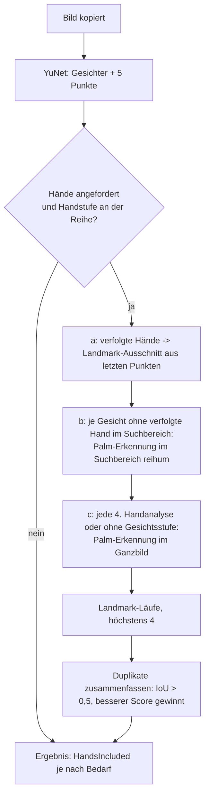
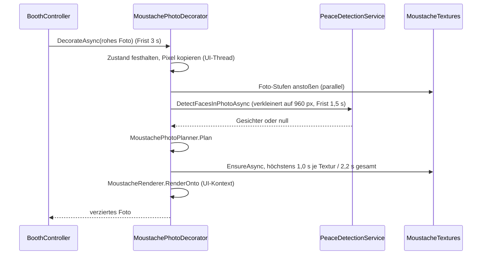

# Fun „Peaceerkennung“ und „Mittelfingererkennung“

Stand: 2.5.1 (ergänzt um die Herzerkennung, siehe [fun-herz-kisscam.md](fun-herz-kisscam.md)). Beide Funktionen sind versteckte Extras („Easter Eggs“): Die Gastansicht verrät nichts davon (kein Hinweistext). Sie teilen sich Dienst, Modelle, Analyserate und Vorschau (auch mit der Herzerkennung). Pfade sind relativ zum Repo-Root.

| Schicht | Dateien |
|---|---|
| Einstellungen | `src/Fotobox/Core/Settings.cs` (`PeaceSettings`, `MiddleFingerSettings`, `MiddleFingerTargets`, `SettingsLimits.Peace*`/`MiddleFinger*`), Normalisierung in `Services/Storage/SettingsNormalizer.cs` |
| UI-freie Logik | `src/Fotobox/Core/Peace/` (`PeaceEngine`, `PeaceGestureClassifier`, `MiddleFingerEngine`, `MiddleFingerGestureClassifier`, `HandPoseMath`, `HandTracker`, `FaceTracker`, `HandFaceMatcher`, `MoustacheTracker`, `MoustacheGeometry`, `MoustacheMotion`, `MoustacheStyles`, `MoustachePhotoPlanner`, `OneEuroFilter`, `PeaceModels`, `PeaceContracts`, `GuestMoustacheState`) |
| Erkennung | `src/Fotobox/Services/Detection/Peace/` (`PeaceDetectionService` + `.Pipeline.cs`, `YuNetFaceDetector`, `MediaPipeHandDetector`, `PalmDecoder`, `YuNetDecoder`, `HandRoiMath`, `AffineCrop`, `InertGestureDetectionService`) |
| Foto-Verzierung | `src/Fotobox/Services/Peace/MoustachePhotoDecorator.cs`, `NullPhotoDecorator.cs` |
| Darstellung | `src/Fotobox/Views/Booth/Peace/` (`PeaceOverlay`, `MoustacheTextures`, `MoustacheShapes`, `MoustacheRenderer`, `MoustachePalette`, `SelfDestructOverlay`) |
| Ansichtsmodelle | `ViewModels/Booth/PeaceOverlayViewModel.cs`, `BoothViewModel.cs` (`UpdatePeace`, `OnPeaceAction`, `OnMiddleFinger`) |
| Admin | `Views/Admin/PeaceSettingsView`, `MiddleFingerSettingsView`, `ViewModels/Admin/AdminViewModel.Peace.cs`, `AdminViewModel.MiddleFinger.cs`, `PeacePreviewStatusFormatter.cs`, `AdminInfoTexts.cs` |
| Modelle | `src/Fotobox/Assets/Models/` |

---

# Teil 1: Peaceerkennung

## Funktion

Zeigt ein Gast im `Idle` ein Peace-Zeichen (✌) und hält es, läuft eine der angehakten Aktionen (bei mehreren zufällig):

- **Selbstzerstörung:** roter Alarm-Countdown, Foto genau im Moment der Explosion; Esc bricht still ab.
- **Foto:** Foto mit eigenem Countdown (kleines ✌ neben den Ziffern).
- **Schnurrbart:** Bart auf allen Gesichtern bzw. nur beim Zeigenden, im Livebild und im Foto; optional danach Auto-Foto.

Alle Peace-Fotos sind Einzelfotos (Streifen werden zu `GuestLayout.Single`, Overlay bleibt); der Ablauf danach ist normal. Peace hat Vorrang vor der Zielerfassung: Bei Selbstzerstörung/Foto ist sie im Countdown ohnehin aus, beim Bart läuft sie im `Idle` weiter. Erneutes Peace bei sichtbarem Bart löst eine neue Aktion aus.

## Einstellungen (`AppSettings.Peace`, `PeaceSettings`)

Flacher, eigener Abschnitt (damit `FunOverlayViewModel.SameSettings` der Zielerfassung nicht reagiert). Wertebereiche in `SettingsLimits.Peace*`.

| Eigenschaft | Standard | Bereich | Bedeutung |
|---|---|---|---|
| `Enabled` | an | | Peaceerkennung insgesamt |
| `ActionSelfDestruct` / `ActionPhoto` / `ActionMoustache` | an / aus / aus | | Aktionen; der Normalizer erzwingt mindestens eine (sonst Selbstzerstörung), im Admin blockiert eine fehlende Aktion das Speichern |
| `HoldMilliseconds` | 1000 | 300–3000 ms, Schritt 100 | Haltedauer |
| `ShowHoldProgress` | aus | | Fortschrittsring an der Hand (verrät die Funktion) |
| `CooldownSeconds` | 0 | 0–600 s | Sperrzeit nach einer Auslösung |
| `SensitivityPercent` | 50 | 10–95 | Empfindlichkeit |
| `AnalysesPerSecond` | 5 | 1–10 | Analysen/s (Rechenlast); gilt auch für die Mittelfingererkennung |
| `SelfDestructSeconds` | 10 | 5–30 s | Dauer des Alarm-Countdowns |
| `SelfDestructSoundEnabled` | aus | | Sirene, Ticks, Explosion |
| `PhotoCountdownSeconds` | 3 | 0–30 s | Countdown der Aktion Foto (0 = sofort) |
| `MoustacheTargets` | `Everyone` | `Everyone`, `PeaceShower` | Wer einen Bart bekommt |
| `MoustacheStyle` | `Random` | `Random`, `Twirl`, `Walrus`, `Chevron`, `Brush`, `Handlebar`, `FuManchu`, `Horseshoe` | Form (nur hinten erweitern) |
| `RandomStyles` | alle sieben | | Formen, aus denen `Random` würfelt |
| `MoustacheVisibility` | `UntilPhotoOrGone` | `UntilPhotoOrGone`, `FixedDuration` | Sichtbarkeit |
| `MoustacheDurationSeconds` | 15 | 3–120 s | feste Dauer |
| `MoustacheAutoPhoto` | aus | | Auto-Foto nach dem Bart |
| `MoustacheAutoPhotoCountdownSeconds` | 3 | 0–30 s | Countdown des Auto-Fotos |

Abgeleitet (`[JsonIgnore]`): `HasAnyAction`; `MinHandScore` linear aus der Empfindlichkeit (10 → 0,9, 95 → 0,55, auf 0,55 … 0,9 geklemmt). `RandomStyles` normalisiert `MoustacheStyles.NormalizeRandomStyles`: unbekannte Werte, `Random` und Duplikate fallen weg, Enum-Reihenfolge, leer ergibt alle. Der Haltedauer-Normalizer rundet auf 100er-Schritte. Der Abschnitt ist übertragbar (Export/Import).

## Modelle

| Datei | Zweck | Quelle/Lizenz |
|---|---|---|
| `palm_detection_full_inf_post_192x192.onnx` | Handflächen (Palm Detection) | MediaPipe (Google), ONNX-Export von PINTO0309, Apache-2.0 laut Model Card |
| `hand_landmark_sparse_Nx3x224x224.onnx` | 21 Handpunkte | wie oben |
| `face_detection_yunet_2026may.onnx` | Gesichter + 5 Punkte | YuNet, OpenCV Zoo, MIT |

Nachweise stehen in `THIRD-PARTY-NOTICES.txt` (Repo-Root, wird mitgeliefert). Der Publish wird je Architektur um ca. 15,6 MB größer. Alle laufen mit ONNX Runtime auf der CPU.

## `PeaceDetectionService` (`IGestureDetectionService`, Singleton)

Verhalten wie `PersonDetectionService` (siehe `docs/fun-zielerfassung.md`): Anforderungen auf einem Stapel (`IGestureRequest`, die Admin-Vorschau überholt die Gastansicht), `FrameArrived` wird nur bei offener Anforderung abonniert, Kamera-Handler kehrt sofort zurück, höchstens eine Analyse zugleich, Frist 2 s, Sessions hinter `DeferredReleaseGate`, Detektoren laden lazy beim ersten Bedarf.

| Konstante | Wert |
|---|---|
| `AnalysisTimeout` | 2 s |
| `InitTimeout` | 20 s (Dienst; je Detektor 15 s) |
| `DisposeWait` | 1,5 s (Detektoren warten höchstens 1 s) |
| `MaxCopyWidth` | 1920 px (Kopie per Nearest, Wechselpuffer) |
| `FailureLimit` | 3 Fehlschläge/Timeouts in Folge machen eine Stufe unbrauchbar |
| `MaxPalmRuns` / `MaxLandmarkRuns` | 3 / 4 je Zyklus |
| `FullImageInterval` | jede 4. Handanalyse sucht im Ganzbild |
| `PhotoMinFaceScore` | 0,6 |
| `StatsInterval` | 30 s |

Ein Frame wird nicht verarbeitet, solange eine Foto-Gesichtserkennung (`DetectFacesInPhotoAsync`) die Live-Analyse pausiert (`_pauseCount`, `_liveGate`). Die Rate wird auf 1–30 geklemmt (UI erlaubt 1–10, im schnellen Gesichtsmodus bis 20).

### Bedarf einer Anforderung

`GestureRequestOptions(Needs, AnalysesPerSecond, MinFaceScore, MinHandScore, HandCycleDivisor = 1)`; `GestureNeeds` = `Faces`, `Hands` (Flags). Läuft eine Anforderung nur mit Gesichtern, entfällt die Handstufe. Hände brauchen aber die Gesichtsstufe für die Suchbereiche (ist sie defekt, wird im Ganzbild gesucht).

### Analysezyklus (`RunCycleAsync`)

- **Suchbereich** um ein Gesicht (`SearchRegion`, Gesichtsbreite `fw`): quadratisch, Seite 7 fw, x ∈ Mitte ± 3,5 fw, y von Mitte − 2 fw bis Mitte + 3 fw, aufs Bild begrenzt.
- **Verfolgte Hände** überspringen die Palm-Erkennung (Ausschnitt aus den letzten 21 Punkten). Palm-Läufe zählen gegen `MaxPalmRuns`; je Suchbereich höchstens 2 Handflächen (`PalmsPerRegion`).
- **Palm-Modell:** 192 × 192, Vorverarbeitung RGB 0–1, quadratisches Fenster mit schwarzem Rand, Mindestscore 0,5. **Landmark-Modell:** 224 × 224, gedrehter Ausschnitt (`AffineCrop`), 21 Punkte.
- **YuNet:** verkleinert intern auf höchstens 640 px Breite, Eingabe auf Vielfache von 32 aufgefüllt.
- **Duplikate:** ROI-Abstand < 0,35 × größere ROI-Seite bzw. Box-IoU > 0,5 zählen als dieselbe Hand.
- **Aufwärmläufe** gehören zur Ladefrist.

### Schneller Gesichtsmodus

Ist im `Watching` ein Bart sichtbar, fordert `PeaceOverlayViewModel` (`BuildOptions`/`RefreshRequest`, auch in der Admin-Vorschau) `HandCycleDivisor` = 2 an:

- Zyklusrate = `clamp(max(10, 2 × eingestellte Rate), 1 … 20)` pro Sekunde.
- Die Handstufe läuft nur in jedem 2. Zyklus; die effektive Handrate bleibt die eingestellte und gilt weiter für die `PeaceEngine`-Fristen.
- Gesichter kommen vorab als eigenes Update (`GestureUpdate.HandsIncluded = false`); das spätere Hand-Update wiederholt sie mit `FacesFresh = false` (sie werden nicht erneut verfolgt oder dem Bart gemeldet, das verfälschte Geschwindigkeit und Glättung; sie dienen nur der Handzuordnung). `GestureUpdate.FrameTime` ist die Eingangszeit des Frames.

Im Countdown/Foto-Folgemodus (`FollowMoustache` ohne Mittelfinger-Bedarf) laufen nur Gesichter mit 10/s (`FollowRate`).

### Messung, Status, Fehler

- Der Dienst misst YuNet-, Palm-, Landmark- und Gesamtzeit je Zyklus; alle 30 s steht eine Logzeile mit Mittel/Max und Analysen/s im Log. `GestureStatus` trägt `FacesReady`, `HandsReady`, Ausfallgründe (`FaceUnavailableReason`, `HandUnavailableReason`), `AnalysesPerSecond` und `MeanCycleMs`; die Admin-Statuszeile zeigt „Analyse ⌀ X ms“.
- Drei Fehlschläge in Folge machen eine Stufe unbrauchbar (Grund in Status und Log; die Gastansicht bleibt still). Fehlt das Gesichtsmodell (`FaceMissingReason`), fällt die Aktion Bart aus der Auswahl und der Admin warnt; fehlt das Handmodell (`HandMissingReason`), ist die Peaceerkennung nicht verfügbar.
- **Foto-Gesichtserkennung** (`DetectFacesInPhotoAsync(photo, timeout, ct)`): pausiert die Live-Analyse, wartet auf eine laufende Analyse (Wartezeit zählt zur Frist), liefert bei Fehler/Timeout `null`.
- **Ohne angeforderte Hände** meldet der Dienst leere Handlisten mit `HandsIncluded = true` (der Zyklus lief ja, nur ohne Handstufe).

## `PeaceEngine` (UI-frei, `TimeProvider`)

`Core/Peace/PeaceEngine.cs`: ordnet Hände zu (`HandTracker`), prüft das Zeichen, misst die Haltedauer und löst genau eine Aktion aus (`Triggered` mit `PeaceTrigger`: Aktion, Hand-Id, Gesichts-Id, Handmitte). Nicht threadsicher (UI-Thread).

| Mechanismus | Verhalten |
|---|---|
| Haltedauer | Beginnt, wenn eine Hand Peace zeigt, die Engine scharf und `GesturesEnabled` ist; nach `HoldMilliseconds` gewinnt die Hand mit dem frühesten Beginn |
| Aussetzer-Frist (`GapTolerance`) | `max(250 ms, 2,5 × Analyseabstand)`; ein längerer Aussetzer setzt das Halten zurück |
| Wiederscharf-Frist (`RearmQuietTime`) | `max(400 ms, 2,5 × Analyseabstand)` |
| Faktor | `PeaceEngine.AnalysisIntervalFactor` = 2,5; Analyseabstand = 1 / `AnalysesPerSecond` |
| Sperrzeit | `CooldownSeconds` ab der Auslösung |
| Nach Auslösung | Engine entwaffnet; „Hand muss erst runter“ |
| Handverlust | `HandTracker.LostAfter` = Analyseabstand-Faktor (mindestens 400 ms) |
| `GesturesEnabled` | nur im `Watching`; bei false kein Halten, aber die Ruheprüfung läuft weiter |
| Aktionswahl | angehakte Aktionen, Bart nur wenn die Gesichtserkennung bereit ist; mehrere = zufällig; keine verfügbar → nur Log |

**Neu in 2.5.1 – Wiederscharf nur nach beobachteter Ruhe.** Früher reichte die Uhrzeit: War lange genug kein Peace gesehen worden, wurde die Engine wieder scharf. Während Foto und Vorschau liefert der Dienst aber nur Gesichter, es gibt also keine Hand-Updates; eine unbemerkt oben gebliebene Hand löste dann sofort erneut aus. Jetzt gilt:

- Die Engine führt mit (`TrackObservedQuiet`), seit wann **lückenlos in Hand-Updates** beobachtet kein Peace gezeigt wurde. Eine Lücke zwischen zwei Hand-Updates, die länger als `RearmQuietTime` ist, war unbeobachtet und startet die Ruhe neu.
- Wieder scharf wird sie nur, wenn Sperrzeit vorbei, seit dem letzten Peace `RearmQuietTime` vergangen **und** die beobachtete Ruhe mindestens `RearmQuietTime` dauerte.
- `Reset()` (Betriebsart aus) behält die Entwaffnung und verlangt, die Ruhe nach dem Reset neu zu beobachten.
- Zusätzlich füttert `PeaceOverlayViewModel.OnUpdated` die Engine **nur bei angeforderten Händen** (`Needs` enthält `Hands`). Bei reiner Gesichtsanforderung meldet der Dienst leere Handlisten mit `HandsIncluded = true`; die Engine dürfte sie sonst als beobachtete Ruhe werten und ohne Handdaten wieder scharf werden. So löst ein über Foto und Vorschau gehaltenes Peace nach dem Bart nicht erneut aus. Die `MiddleFingerEngine` bekommt die Updates weiterhin.

## Klassifikator (`PeaceGestureClassifier`, `HandPoseMath`)

Regel auf den 21 MediaPipe-Punkten (0 Handgelenk; 5–8 Zeigefinger, 9–12 Mittel, 13–16 Ring, 17–20 klein; je MCP, PIP, DIP, TIP): Zeige- und Mittelfinger **gestreckt und gespreizt**, Ring- und kleiner Finger **gebeugt**, Daumen egal; unabhängig von Drehung, Spiegelung und Handgröße (nur Längen- und Winkelverhältnisse).

- `ToIsotropic`: X und Z mal Bildseitenverhältnis `aspect` (Z hat die Größenordnung von X), damit Abstände isotrop sind.
- `IsExtended(mcp, Faktor, Winkel)`: Spitze weiter vom Handgelenk als das PIP-Gelenk (× Faktor) und der PIP-Winkel MCP–PIP–TIP über dem Grenzwert. `IsFolded`: Spitze näher am Handgelenk als das PIP-Gelenk oder näher als 0,6 × Handgröße an der Handfläche.
- Gespreizt: Winkel der Fingerrichtungen > Grenzwert oder Spitzenabstand > 0,3 × Handgröße.

| Schwelle (Empfindlichkeit 10 % → 95 %) | streng | locker |
|---|---|---|
| Streckungsfaktor | 1,25 | 1,05 |
| PIP-Winkel | 165° | 140° |
| Spreizwinkel | 25° | 10° |
| Mindest-Handscore | 0,9 | 0,55 |

Ablehnungsgründe (`PeaceVerdict.RejectReason`) sind kurze deutsche Texte nur für Log/Admin.

## Tracker

- `HandTracker`: stabile Ids über Handgelenkabstand (≤ 1,0 Handgrößen) bzw. Boxen-IoU ≥ 0,3; Verlustfrist 400 ms (bei seltenen Analysen länger). `HandFaceMatcher`: Hand → nächstes Gesicht (Handgelenk – Gesichtsmitte höchstens 4,5 Gesichtsbreiten).
- `FaceTracker`: gierig nach IoU ≥ 0,3 oder Mittenabstand < 0,5 Gesichtsbreiten; aktive Spuren zuerst, danach greifen übrige Gesichter kürzlich verlorene Spuren auf (Abstand < 1 Gesichtsbreite zur fortgeschriebenen Mitte, gemessen an der größeren Boxbreite; Vorhersage höchstens 0,5 s; Geschwindigkeit auf 3 Gesichtsbreiten/s begrenzt). `ScoreLost`: Überdeckung bezogen auf die kleinere Box, `MinLostContainment` 0,5 – ein deutlich größer zurückkehrendes Gesicht behält seine Id. Verlustfrist mindestens 700 ms, bei seltenen Analysen länger.
- `MoustacheTracker`: Siehe unten.

## Schnurrbart

### Geometrie (`MoustacheGeometry.FromFace`)

Lage aus dem **Augenabstand**, weil die Mundwinkel (YuNet) aus der Nähe, beim Lachen und perspektivisch unzuverlässig sind. Gerechnet wird in Bildpixeln (Seitenverhältnis), die Mitte wird wieder normiert (ungespiegelt).

| Größe | Formel |
|---|---|
| Breite | `1,16 × Augenabstand`; der Mundwert (`1,7 × Mundbreite`) darf sie nur um ±10 % verändern |
| Anker | Nase + `0,55 ×` seitlicher Anteil Nase→Mundmitte + `0,325 × Augenabstand` nach unten (Gesichtssenkrechte aus der Augenlinie); der Mundwert (`0,55 ×` Anteil Nase→Mund quer zur Augenlinie) darf die Höhe nur um ±0,05 × Augenabstand verschieben |
| Winkel | gewichtetes Mittel der Einheitsvektoren von Augenlinie (Gewicht 2) und Mundlinie (Gewicht 1) |
| Vertauschte Bezeichnungen | erkennt die Richtung Nase→Mund; Augen-/Mundlinie werden gedreht, damit der Bart nicht über der Nase oder auf dem Kopf steht |
| Ohne Augenlinie | alte Mundformel (Nase + 0,55 × Weg zur Mundmitte, Breite `1,7 × Mundbreite`), ohne Mundbreite die Gesichtsbox (0,5 × Breite) |

Kalibrierung: Für ein neutrales Gesicht (Mundbreite ≈ 0,68, Nase→Mundmitte ≈ 0,59 Augenabstände, wie in den Tests) ergibt die Augenformel dieselbe Breite und Höhe wie die frühere Mundformel. Die Faktoren sind nur auf synthetische Proportionen kalibriert (siehe `docs/bekannte-grenzen.md`).

### Glättung und Verfolgung (`MoustacheTracker`, `OneEuroFilter`)

Der One-Euro-Filter (Casiez et al.) glättet im Stillstand stark und lässt mit wachsender Geschwindigkeit nach. Mitte und Breite werden in Bildpixeln gefiltert, die Geschwindigkeit in Gesichtsbreiten/s gemessen (abstandsunabhängig).

| Parameter | Wert |
|---|---|
| `MinCutoff` | 0,8 Hz (bei 10 Beobachtungen/s rund 30 % Gewicht der neuen Messung im Stillstand) |
| Beta Mitte / Breite / Winkel | 10 / 6 / 8 |
| `VelocityCutoff` | 2 Hz |
| Neustart der Glättung | bei Lücke > `SmoothingGap` 700 ms |
| `MinSampleInterval` | 20 ms (dichtere Beobachtungen werden nicht gefiltert) |
| Vorhersage | die angezeigte Mitte wird um das Alter der Beobachtung fortgeschrieben, höchstens `MaxPredictionAge` 150 ms und 0,3 Gesichtsbreiten; Totband 0,25 Gesichtsbreiten/s; Winkel und Breite nie |
| Foto-Pfad | `ExportPlanInput` nutzt die gefilterte Lage ohne Vorhersage |
| Zeichnen ohne frische Beobachtung | `ViewTimeout` 700 ms |
| „Bis Foto/Verschwinden“ endet | wenn alle bebarteten Gesichter länger als `GoneTimeout` 1,5 s fehlen |
| Start einer Sitzung | Gesichter, die höchstens `SeedMaxAge` 1 s alt sind, bekommen sofort einen Bart |

- Stil und Farbe je Gesicht stabil (gewürfelt beim ersten Erscheinen); die feste Dauer (`FixedDuration`) wird im Countdown/Aufnahme angehalten (`SetHoldExpiry`); `OnPhotoCompleted` beendet „bis zum nächsten Foto“.
- `PeaceOverlay` gleitet in 40–200 ms passend zum Abstand der Updates (Start 120 ms, geglättet 0,5/0,5).

### Formen, Farben, Textur

- **Sieben Formen:** `Twirl` „Zwirbel“, `Walrus` „Walross“, `Chevron`, `Brush` „Pinsel“, `Handlebar` „Dalí“, `FuManchu` „Fu Manchu“, `Horseshoe` „Hufeisen“ (`MoustacheStyle` nur hinten erweitern). `MoustacheShapes` baut sie als Streifen aus der Mittellinie; `Normalize` normiert nur in x, damit der Ursprung auf der Oberlippe bleibt. Eine Quelle für die Auswahl: `Core/Peace/MoustacheStyles.cs`.
- **Farben** (`MoustacheColor`, nur hinten erweitern): `Black`, `DarkBrown`, `Brown`, `Ginger`, `Blond`, `Gray` (Salz und Pfeffer). Palette `Views/Booth/Peace/MoustachePalette.cs`: je Farbe vier Stufen Wurzel → Spitze. Keine Einstellung: zufällig je Spur, stabil, im Foto gleich, weil `MoustachePhotoPlanner` Form und Farbe der Live-Spur übernimmt.
- **`MoustacheTextures`:** eingefrorene, gecachte Haartextur je (Form, Farbe, Stufe). Offscreen vorberechnet: Unterwolle, viele Haarstriche mit festem Seed (deterministisch) entlang der Wuchsrichtung, am Rand ausfransend, weicher Schatten per Box-Blur auf den Pixeln (kein `BlurEffect`).

| Aspekt | Wert / Verhalten |
|---|---|
| Stufen | 256, 512, 1024, 2048 px je Einheit (`Tiers`); gewählt wird die kleinste Stufe, die mindestens so breit ist wie der Bart gezeichnet wird |
| Thread | eigener STA-Thread, Priorität `BelowNormal` (WPF-Rendern braucht STA), höchstens eine Erzeugung je Schlüssel |
| Dauer | je Stufe 0,1 bis über 3 s (Walross Stufe 2048 kalt, Debug) |
| Fehler | geloggt, höchstens `MaxAttempts` = 3 Versuche je Schlüssel |
| Cache | Stufen ab `LargeTierFrom` 1024 auf `MaxLargeEntries` = 8 begrenzt (am längsten ungenutzt zuerst); ausgelieferte Texturen sind eingefroren und unabhängig vom Cache |
| UI-Pfade | blockieren nie: `TryGetReady` liefert sofort die passende oder nächstbeste fertige Stufe (nächstgrößere, sonst größte kleinere) und startet die fehlende im Hintergrund; `TextureReady` lässt `PeaceOverlay`/`MoustacheSketch` per Dispatcher neu zeichnen (Abo in `Loaded`/`Unloaded`). Ohne fertige Textur fehlt der Bart in dem Frame, das Plopp startet erst mit dem ersten sichtbaren Frame |
| Zeichnen | `MoustacheRenderer.Draw`/`RenderOnto` sind nur `DrawImage` und erzeugen nie |
| Blockierend | nur `Get`/`GetTier` (Prewarm-Arbeiter, Tests) |
| Test-Hooks | `Factory`, `Isolate()` |
| Prewarm | `App.PrewarmMoustacheTextures` reiht beim Start und nach jedem `SettingsChanged` einen Arbeiter ein, nur bei aktivem Peace mit Aktion Bart (Stufen 256/512, alle Farben, gewählte bzw. Zufallsformen); die Foto-Stufe entsteht beim ersten Bart vorab |

`UnitRect` bildet das Einheitsmaß ab: Ursprung = Mitte der Oberlippe, Breite der Form = 1, das Bild ragt mit Rand (Seite/oben 0,05, unten 0,11) für Fransen und Schatten darüber hinaus. Admin-Skizzen zeigen die Textur auf Hautton.

### Bewegung (`MoustacheMotion`)

| Effekt | Verhalten |
|---|---|
| Plopp (`MoustachePop`) | beim Erscheinen 0,35 s gedämpfte Feder (Dämpfungsgrad 0,55, rund 12 % Überschwinger) |
| Wippen (`MoustacheWobble`) | Feder mit 6 Hz, Dämpfung 0,22, höchstens 3 % Breite und 2°; angestoßen durch die Mundgeometrie (nur die Mundwinkel, YuNet liefert keine Lippenpunkte); nur im Livebild, nicht im Foto |
| Verschwinden (`MoustacheVanish`) | 0,3 s: kurzer Überschwinger auf 1,08 im ersten Viertel, dann beschleunigtes Einschrumpfen auf 0 |

## Foto: `MoustachePhotoDecorator` und Planner

`IPhotoDecorator` (vom `BoothController` je Aufnahme zwischen `CapturePhotoAsync` und dem Spiegeln aufgerufen; Frist `PhotoDecorateTimeout` 3 s; Fehler/Timeout = unverziertes Foto). Zeichnet den Bart aufs rohe, ungespiegelte Foto – auch die Originale tragen ihn.

- Gesichtssuche: `PhotoFaceTimeout` 1,5 s (+ 1 s Hartlimit-Reserve), Bild auf `MaxDetectionWidth` 960 px verkleinert.
- Texturen: `TextureBudget` 1,0 s, `OverallBudget` 2,2 s (Reserve für `RenderOnto` unter der 3-s-Frist); sonst beste fertige Stufe bzw. unverziertes Foto mit Log.
- `MoustachePhotoPlanner`: ordnet Foto-Gesichter den Live-Spuren zu (IoU ≥ 0,3 oder Mittenabstand < 0,5 Gesichtsbreiten), übernimmt Form und Farbe der Spur; Gesichter ohne Spur bekommen gewürfelte Form/Farbe (außer bei `PeaceShower`); Spuren, die das Foto nicht fand und höchstens `LivePoseMaxAge` 500 ms verloren sind, behalten die letzte Live-Pose; scheitert die Suche (`null`), gelten alle Live-Posen.
- DI: Dienst und Decorator Singletons; `BoothController` bekommt den Decorator über den optionalen Konstruktorparameter. Ohne Peace gilt `NullPhotoDecorator`.

## `PeaceOverlayViewModel`

Je Gastansicht und Admin-Vorschau eine Instanz; nur die Gastansicht bekommt `GuestMoustacheState` (damit ein Admin-Test nie in ein echtes Foto gerät). Hält Anforderung, `PeaceEngine`, `MiddleFingerEngine`, `FaceTracker`, `MoustacheTracker`, 100-ms-Tick und Töne – und seit der Kisscam zusätzlich die `HeartEngine` (partial `PeaceOverlayViewModel.Heart.cs`): Der Gestendienst bedient nur die oberste Anforderung, die Herzerkennung teilt sich daher Anforderung, Hände und Analyserate mit Peace (Details und die Pipeline-Option `PairedHands`: `fun-herz-kisscam.md`).

`SetMode(mode, settings, mirror, middleFinger, external, heart, peaceGestures)`: Mit `peaceGestures` = false (Peace ausgeschaltet, Herz an) werden die Peace-Gesten nicht ausgewertet; Bärte und Mittelfinger bleiben davon unberührt. `BoothViewModel.UpdatePeace` läuft, sobald Peace **oder** Herz eingeschaltet ist; der Mindest-Handscore der Anforderung ist das Minimum der aktiven Funktionen.

| `PeaceMode` | Bedeutung | Anforderung |
|---|---|---|
| `Off` | keine Erkennung | Anforderung geschlossen, Tracker/Engines geleert, Bart-Sitzung beendet |
| `Watching` | Leerlauf | Gesichter + Hände mit der eingestellten Rate; mit sichtbarem Bart schneller Gesichtsmodus |
| `FollowMoustache` | Bart folgt dem Gesicht (Countdown, Vorschau) | nur Gesichter mit 10/s; Hände nur, solange `MiddleFingerWatching` gilt |

Ein Wechsel zwischen `Watching` und `FollowMoustache` ändert nur die Anforderung (`IGestureRequest.Update`), nie Engine, Tracker oder Anforderung selbst, damit ein Bart den Countdown übersteht. In `FollowMoustache` werden nie Aktionen ausgelöst.

### `BoothViewModel.UpdatePeace` / `OnPeaceAction`

`UpdatePeace` (in `Refresh`, bei `IsAdminOpen`, `Shutdown`) bestimmt die Betriebsart: `Watching` im `Idle` bei laufender Kamera und geschlossenem Admin; in den Foto-Zuständen `FollowMoustache` nur bei aktivem Bart (bzw. Mittelfinger-Bedarf, siehe Teil 2), sonst `Off` (auch bei Video, Fehler, ausgeschaltetem Schalter). Beim Eintritt in `Preview` ruft es einmal `OnPhotoCompleted`.

`OnPeaceAction` (gesperrt wie `TryTrigger()` bei offenem Admin/startender Kamera; Rest prüft der Controller) ruft `BoothController.TryTrigger(TriggerOptions { Layout, SingleShotOnly, CountdownSeconds, Style })` mit dem gewählten Gast-Layout und setzt die Mausradwahl danach zurück:

| Aktion | Countdown | `CountdownStyle` |
|---|---|---|
| `SelfDestruct` | `SelfDestructSeconds` | `SelfDestruct` |
| `Photo` | `PhotoCountdownSeconds` | `Peace` |
| `Moustache` | `Peace.StartMoustache`; mit `MoustacheAutoPhoto` danach Foto mit `MoustacheAutoPhotoCountdownSeconds` | `Peace` |

`BoothController.CountdownStyle` (`Normal`/`Peace`/`SelfDestruct`/`Kisscam`) gilt bis zum Durchgangsende.

### Selbstzerstörung: Explosion statt Blitz, Töne

- Der Stil wird beim `FlashRequested` auf dem Controller-Thread gelesen; das ViewModel löst bei Selbstzerstörung `ExplosionRequested` statt `FlashRequested` aus.
- Weil der Zustand beim Blitz schon `Capturing` ist, hängt `SelfDestructOverlay` (Geschwister nach dem Countdown-Grid, nicht darin) an `ShowSelfDestruct` = Stil `SelfDestruct` und (Countdown oder `Capturing` bis 1,2 s nach dem Blitz, `ExplosionDuration`); sonst wirkt `PlayExplosion` auf ein unsichtbares Overlay nicht. Die Alarm-Ansicht bleibt nach der Explosion bis 1,2 s sichtbar.
- Töne (`FunSoundCue.SelfDestructTick`/`SelfDestructTickFast`/`Explosion`, synthetisiert, nur mit `SelfDestructSoundEnabled`; die Prüfung steckt in `PeaceOverlayViewModel`): Tick bei jedem Countdown-Wert (≤ 3 s: schneller Tick), `StopSounds` nur beim Verlassen des Countdowns ohne Aufnahme (Esc), nie beim Übergang in die Aufnahme.

---

# Teil 2: Mittelfingererkennung

## Funktion und Einstellungen

Zeigt ein Gast den Mittelfinger und hält ihn, hebt das **Peace-Effekte auf**: Schnurrbärte verschwinden (0,3-s-Animation), eine laufende Selbstzerstörung wird still abgebrochen. Außerdem bricht er eine laufende **Kisscam** ab (Aktion „Kisscam abbrechen“, `fun-herz-kisscam.md`). Wirksam, solange die Peace- **oder** die Herzerkennung eingeschaltet ist (er nutzt deren Dienst, Hände und `PeaceOverlayViewModel`); sind beide aus, passiert nichts (der Admin warnt).

`AppSettings.MiddleFinger` (`MiddleFingerSettings`, eigener flacher Abschnitt, nur Werttypen):

| Eigenschaft | Standard | Bereich | Bedeutung |
|---|---|---|---|
| `Enabled` | an | | Mittelfingererkennung |
| `ActionCancelPeace` | an | | Aktion „Peace-Effekte aufheben“ (weitere Aktionen als Bools hinten anfügen; der Normalizer erzwingt mindestens eine, `HasAnyAction`; im Admin blockiert eine fehlende Aktion das Speichern, die letzte gesetzte Aktion ist gesperrt) |
| `ActionCancelKisscam` | an | | Aktion „Kisscam abbrechen“: der Mittelfinger beendet den laufenden Kisscam-Countdown ohne Foto (wie die Abbrechen-Taste) |
| `HoldMilliseconds` | 500 | 200–3000 ms, Schritt 100 | Haltedauer |
| `SensitivityPercent` | 50 | 10–95 | Empfindlichkeit |

Die **Analysenrate** (`AnalysesPerSecond`) ist kein eigenes Feld: Neu in 2.5.1 ist „Analysen pro Sekunde“ auch auf der Mittelfinger-Seite einstellbar – es ist **derselbe Wert wie bei Peace** (`PeaceSettings.AnalysesPerSecond`, `NumberStepper` bindet an `PeaceAnalysesPerSecond`; Bereich `SettingsLimits.PeaceAnalysesPerSecond*` 1–10). Die Seite verweist darauf („Gilt gemeinsam für Peace- und Mittelfingererkennung“), und ein ⓘ-Tooltip (`AdminInfoTexts.MiddleFingerAnalysesPerSecond`) erklärt es.

`MiddleFingerTargets` ([Flags]: `None`, `Moustache` = 1, `SelfDestruct` = 2, `Kisscam` = 4) sagt, was gerade aufhebbar ist. `MiddleFingerSettings.Wants(present)` = `Enabled` + (`ActionCancelPeace` mit Ziel `Moustache`/`SelfDestruct` **oder** `ActionCancelKisscam` mit Ziel `Kisscam`). Die Peace-Zweige von `OnMiddleFinger` (Selbstzerstörung abbrechen, Bart entfernen) sind an `ActionCancelPeace` gebunden, der Kisscam-Zweig an `ActionCancelKisscam`; `BoothViewModel.UpdatePeace` meldet im Kisscam-Countdown `external = Kisscam`. `MinHandScore` linear aus der Empfindlichkeit (`MinHandScoreFor`: 10 → 0,9, 95 → 0,55; einzige Quelle, auch vom Klassifikator genutzt).

## Klassifikator (`MiddleFingerGestureClassifier`)

Regel auf den 21 Punkten: **Mittelfinger gestreckt**, **Zeige-, Ring- und kleiner Finger gebeugt**, Daumen egal; drehungs-/spiegelunabhängig. Die Geometrie (`ToIsotropic`, `IsExtended`, `IsFolded`) teilt sie über `Core/Peace/HandPoseMath.cs` mit dem Peace-Klassifikator. Die Empfindlichkeit lockert die Streckungsschwellen (Faktor 1,25 → 1,05, PIP-Winkel 165° → 140°) und senkt den Mindest-Handscore (0,9 → 0,55).

## `MiddleFingerEngine` (UI-frei, `TimeProvider`)

- **„Irgendeine Hand“:** keine Handverfolgung; das Halten gilt global.
- Fristen wie bei `PeaceEngine`: `GapTolerance` = `max(250 ms, 2,5 Analyseabstände)`, `RearmQuietTime` = `max(400 ms, 2,5 Analyseabstände)` (`Configure(settings, analysesPerSecond)` erhält die Handrate der Peaceerkennung).
- Löst genau einmal `Triggered` aus (Log: „Mittelfingererkennung: Zeichen erkannt.“) und ist danach erst nach `RearmQuietTime` ohne Mittelfinger wieder scharf.
- **`Applicable`:** Es wird nur gehalten und ausgelöst, solange es etwas aufzuheben gibt. Beim Wechsel `false → true` startet die Engine **entwaffnet** (letzter Mittelfinger = jetzt): Ein beim Senken eines Peace-Zeichens kurz verbleibender Mittelfinger zählt nicht, ein erst nach einer Pause neu erscheinender zählt sofort (auch wenn davor Peace zu sehen war); die Haltedauer fängt kurze Übergangshaltungen ab. `false` beendet ein laufendes Halten.
- `DetectedNow` (Admin-Anzeige) gilt innerhalb der Aussetzer-Toleranz. `Reset()` behält „muss erst verschwinden“.

## `PeaceOverlayViewModel` und `BoothViewModel` für den Mittelfinger

- `SetMode(mode, settings, mirror, middleFinger, external)`: `external` = von außen gemeldete Ziele (z. B. `SelfDestruct` im Selbstzerstörungs-Countdown; ein aktiver Bart zählt von selbst) bestimmt `MiddleFingerWatching`. Die Anforderung (`BuildOptions`) enthält in `FollowMoustache` nur dann Hände, wenn `MiddleFingerWatching` gilt (mit Bart wie im schnellen Gesichtsmodus, sonst mit der eingestellten Rate); sonst bleibt es bei billigen Gesichtern (CPU).
- Der Mindest-Handscore der Anforderung ist, solange etwas aufzuheben ist, das Minimum aus Peace und Mittelfinger.
- Der Mittelfinger wird nur im `Idle` und im `Countdown` beobachtet; in Aufnahme, Vorschau und Druck übergibt `UpdatePeace` keine Mittelfinger-Settings (dort nur Gesichter). Im Selbstzerstörungs-Countdown und solange ein Bart (auch seine Verschwinden-Animation, `HasMoustacheVisuals`) zu sehen ist, bleibt die Erkennung im Countdown an (`FollowMoustache`). Ohne das Feature bleibt alles wie zuvor.
- Auswertung in jeder Betriebsart außer `Off`; `MiddleFingerTriggered` (UI-Thread) – das Ansichtsmodell hebt nichts selbst auf, der Abonnent entscheidet. Weitere Mitglieder: `VanishMoustaches()` (ruft `MoustacheTracker.Dismiss`), `HasMoustacheVisuals`, `MiddleFingerDetectedNow`, `StartTestMoustache(int seconds)`.
- `MoustacheTracker.Dismiss()` friert die Bärte ein (`MoustacheView.Vanishing` = true, Wippen in Ruhe) und beendet die Sitzung sofort (`IsActive` false, `ExportPlanInput` = null: ein Foto danach bekommt keinen Bart); `IsVanishing`/`Views` liefern den eingefrorenen Stand 0,3 s lang; `EndSession` lässt ein laufendes Verschwinden unberührt, `StartSession` beendet es; beim Ausschalten (`Deactivate`) endet es mit (`ClearVanishing`), sonst käme ein Geisterbart.
- **`BoothViewModel.OnMiddleFinger`** (nur ohne Shutdown/offenen Admin und mit `Enabled` + `HasAnyAction`): bricht eine Selbstzerstörung nur per `BoothController.TryCancelCountdown()` still ab (nie `TryCancel`, also nie Video oder Druck; ist schon die Aufnahme gestartet, läuft das Foto weiter), lässt Bärte per `VanishMoustaches()` verschwinden (beides nur mit `ActionCancelPeace`); mit `ActionCancelKisscam` bricht er einen Kisscam-Countdown ebenfalls per `TryCancelCountdown()` ab; andere Countdowns (normal, Peace-Foto, Auto-Foto zum Bart) laufen weiter. Jede Auslösung steht im Log („Kisscam abgebrochen“, „Selbstzerstörung abgebrochen“, „Bart entfernt“ oder „nichts aufzuheben“), Fehler werden geloggt.

---

# Teil 3: Admin-Seiten

Beide Seiten liegen im Tab „Fun“ (Kacheln mit Status „An“/„Aus“, „← Zurück“) und teilen eine Kamera-Vorschau (`AdminViewModel.PeacePreview`, eine `PeaceOverlayViewModel`-Instanz ohne `GuestMoustacheState`). Sie nutzen die Entwurfswerte und lösen nie ein echtes Foto oder einen Druck aus. Änderungen an `PeacePreview*`/`MiddleFingerPreview*`/`MiddleFingerDetected*` lösen keine Entwurfs-Änderungsmeldung aus.

## Seite „Peaceerkennung“ (`PeaceSettingsView`)

- Schalter „Peaceerkennung einschalten“; Vorschau mit Handpunkten und Abzeichen „Peace erkannt ✌“ (bzw. „Foto würde ausgelöst 📷“ für 2 s).
- Knöpfe **„Selbstzerstörung testen“** (Test-Countdown von 5 s, `PeaceTestSelfDestructSeconds`, mit Explosion, ohne Foto) und **„Bart testen“** (Bart ohne Foto für 8 s, `TestMoustacheSeconds`, am erkannten Gesicht bzw. auf einem Platzhaltergesicht). Ohne Kamera funktionieren beide trotzdem.
- Checkbox **„Gesichtspunkte anzeigen“** (`AdminViewModel.PeacePreviewShowFacePoints`, nicht gespeichert, Standard aus): zeichnet die fünf YuNet-Punkte (`PeaceOverlay.Faces`/`ShowFaceLandmarks`); die Gastansicht zeigt sie nie.
- Statuszeile (`PeacePreviewStatusFormatter`): „Hände: n · Gesichter: n · X,Y Analysen/s · Analyse ⌀ N ms · Peace erkannt ✌ · Mittelfinger erkannt“; „Erkennung wird geladen …“, „Die Erkennung ist nicht verfügbar.“, Warnzeile für „Keine Kamera – Vorschau nicht verfügbar.“ und die Ausfallgründe der Stufen; Warnung bei fehlender Gesichtserkennung (Bart nicht verfügbar); Warnung ohne gewählte Aktion.
- Karten: Aktionen (Selbstzerstörung/Foto/Schnurrbart), Auslösung (Haltedauer, Fortschrittsring, Sperrzeit, Empfindlichkeit, **Analysen pro Sekunde** mit ⓘ), Selbstzerstörung (Dauer, Alarmton), Foto (Countdown), Schnurrbart (Wer, Stil mit acht Karten inkl. „Zufällig je Person“, „Beim Zufall verwenden“ – der letzte Haken ist gesperrt –, Sichtbarkeit, Dauer, Auto-Foto).
- **ⓘ-Tooltip** `AdminInfoTexts.PeaceAnalysesPerSecond`: erklärt Rate, Abwägung CPU gegen Reaktion, dass Aussetzer erst nach etwa 2,5 Analyseabständen zählen, dass der Wert für Peace und Mittelfinger gilt, das Hochschalten der Gesichter bei sichtbarem Bart (10–20/s), Empfehlung 5 (schwache PCs 3) und den Tipp zur Statuszeile.

## Seite „Mittelfinger“ (`MiddleFingerSettingsView`, `AdminViewModel.MiddleFinger.cs`)

- Schalter „Mittelfingererkennung aktiv“; Warnung nur, wenn Peace- **und** Herzerkennung ausgeschaltet sind (`HasMiddleFingerPeaceDisabledWarning`; „… ohne sie gibt es nichts aufzuheben“) bzw. bei fehlender Gesichtserkennung.
- Knopf **„Aufheben testen“**: Test-Bart ohne Foto für 20 s (`MiddleFingerTestMoustacheSeconds`) mit Hinweis „Zeigen Sie jetzt den Mittelfinger, um den Bart zu entfernen.“; ein sichtbarer Selbstzerstörungs-Test zählt als aufhebbares Ziel (`external`). Auf dieser Seite löst ein zufälliges Peace in der Vorschau nichts aus (kein überraschender Selbstzerstörungs-Test).
- Karte „Erkennung“: Haltedauer, Empfindlichkeit, **Analysen pro Sekunde** (derselbe Wert wie bei Peace, ⓘ `AdminInfoTexts.MiddleFingerAnalysesPerSecond`), Karte „Aktionen“ (Peace-Effekte aufheben, Kisscam abbrechen; die letzte gesetzte Aktion ist gesperrt).
- `PeacePreviewStatusFormatter.Format(…, middleFingerNow)` ergänzt „Mittelfinger erkannt“; Abzeichen „Mittelfinger erkannt“ im Bild.

„Standardwerte wiederherstellen“ setzt beide Abschnitte zurück.

## Tests

`PeaceEngineTests`, `PeaceGestureClassifierTests`, `PeaceTrackerTests`, `PeaceDetectionServiceTests`, `PeaceOverlayViewModelTests`, `BoothViewModelPeaceTests`, `BoothControllerPeaceTests`, `MoustacheGeometryTests`, `MoustacheTrackerTests`, `MoustacheTexturesTests`, `MoustacheMotionTests`, `MoustachePhotoDecoratorTests`, `MoustachePhotoPlannerTests`, `MoustacheStylesTests`, `MoustacheDismissTests`, `OneEuroFilterTests`, `HandRoiMathTests`, `MiddleFingerEngineTests`, `MiddleFingerGestureClassifierTests`, `MiddleFingerSettingsTests`, `PeaceSettingsTests`, `PeacePreviewStatusFormatterTests`, `AdminPeaceTabTests`, `AdminMiddleFingerTabTests`, `PeaceViewsTests`; synthetische Hände in `PeaceHandFixtures`. Visual-Tests `PeaceVisualRenderTests`, `DetectionPeaceVisualTests` (mit `FOTOBOX_RENDER_DIR` PNGs, sonst No-op). Hardware-Tests `PeaceCameraHardwareTests` laufen nur lokal.
