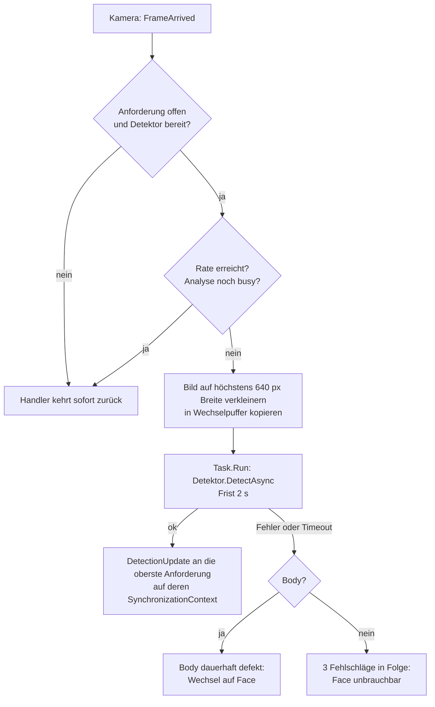
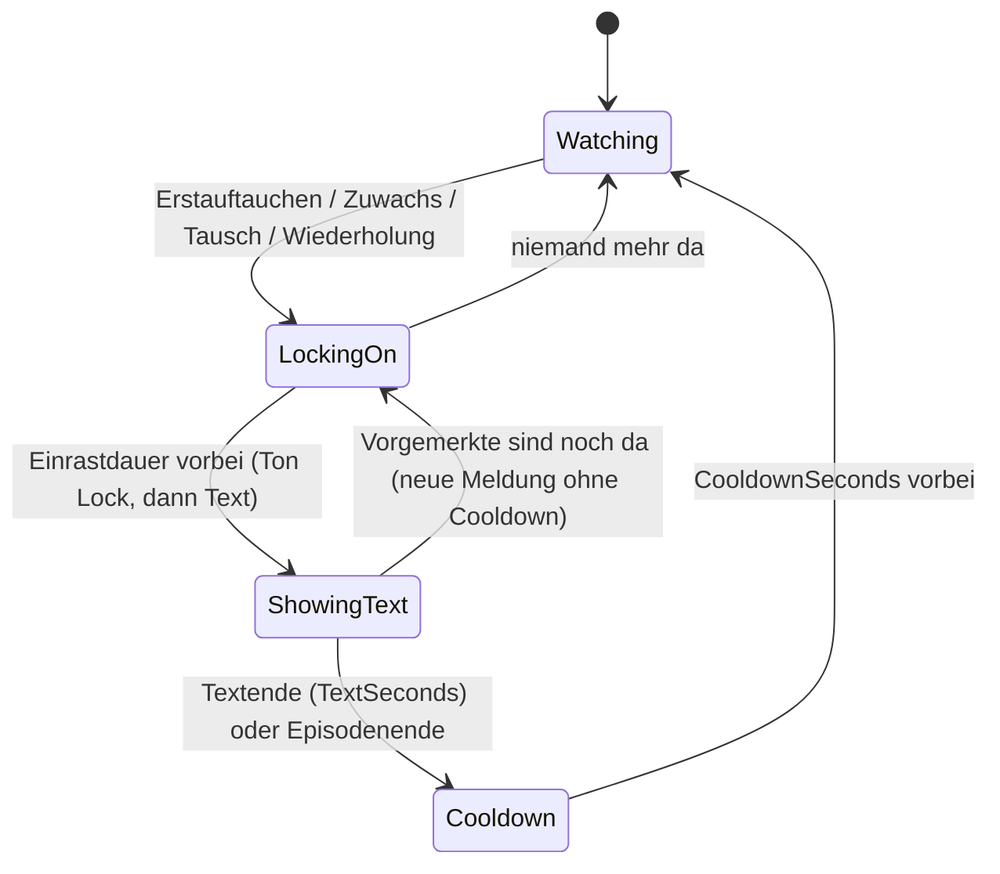

# Fun „Zielerfassung“

Stand: 2.5.1. Dieses Dokument beschreibt die Zielerfassung („Personen im Livebild markieren“) vollständig: Einstellungen, Erkennung, Zustandsmaschine, Töne, Darstellung und Admin-Seite. Es richtet sich an Entwickler und KI-Agenten; Pfade sind relativ zum Repo-Root.

## Überblick

Die Zielerfassung markiert erkannte Personen im Livebild der Gastansicht mit Zielmarken („TARGET 1“, „TARGET 2“ …), lässt sie mit einer Einrast-Animation „einrasten“ und blendet danach einen Spaßtext ein („Hey du, nimm doch ein Foto oder Video mit mir auf!“).

Wichtige Eigenschaften:

- Sie läuft nur in der Gastansicht, nur im Zustand `Idle`, nur bei laufender Kamera und nur bei geschlossenem Admin (`BoothViewModel.UpdateFun`). Mit dem Auslösen ist sie sofort aus.
- Sie ist nur Darstellung: Zielmarken erscheinen nie im Foto und nie im Video (Fotos bestehen aus rohen Kamera-Pixeln, Videos kodiert `MediaCapture`).
- Standardmäßig an (`FunSettings.Enabled`), abschaltbar im Admin.
- Zwei Erkennungsverfahren: Ganzkörper per KI-Modell (YOLOX-Nano, ONNX Runtime) oder Gesichter per Windows-`FaceDetector`.

| Schicht | Dateien |
|---|---|
| UI-freie Logik | `src/Fotobox/Core/Fun/` (`FunEngine`, `TargetTracker`, `TargetGeometry`, `OverlayMapper`, `LockOnTuning`, `ToneSynth`, `FunTextFormatter`, `FunModels`) |
| Erkennung | `src/Fotobox/Services/Detection/` (`PersonDetectionService`, `YoloxPersonDetector`, `YoloxPreprocessor`, `YoloxDecoder`, `WindowsFaceDetector`, `DeferredReleaseGate`) |
| Ton | `src/Fotobox/Services/Audio/FunSoundPlayer.cs` |
| Ansichtsmodell | `src/Fotobox/ViewModels/Booth/FunOverlayViewModel.cs` |
| Darstellung | `src/Fotobox/Views/Booth/TargetOverlay.cs`, `TargetVisual.cs`, `FunText.cs` |
| Admin | Tab „Fun“, Seite „Personen“ in `src/Fotobox/Views/Admin/AdminWindow.xaml`; `ViewModels/Admin/FunPreviewStatusFormatter.cs`, `AdminInfoTexts.cs`; Skizzen `TargetStyleSketch`, `LockOnSketch` |
| Modell | `src/Fotobox/Assets/Models/yolox_nano.onnx` |

## Einstellungen (`AppSettings.Fun`, `FunSettings`)

Wertebereiche stehen einzig in `SettingsLimits.Fun*` (`src/Fotobox/Core/Settings.cs`) und gelten für Admin-UI, Validierung und Normalisierung gleichermaßen (`SettingsNormalizer.NormalizeFun` klemmt Zahlen und setzt unbekannte Enum-Werte auf den Standard). Die Schrittweiten sind reine UI-Schritte; der Normalizer klemmt nur.

| Eigenschaft | Standard | Bereich / Werte | Bedeutung |
|---|---|---|---|
| `Enabled` | an | | Zielerfassung insgesamt |
| `Method` | `Body` | `Body`, `Face` | Wunschverfahren (tatsächlich kann der Dienst auf Gesicht ausweichen) |
| `Scope` | `FullBody` | `Head`, `UpperBody`, `FullBody` | Was die Zielbox umrahmt |
| `BoxStyle` | `Corners` | `Corners`, `Rectangle`, `CornersCrosshair` | Aussehen der Marke (Enum nur hinten erweitern) |
| `Color` | `Red` | `Red`, `Green`, `Cyan`, `Yellow`, `White` | feste Palette (nur hinten erweitern) |
| `Animation` | `ShrinkPulse` | `ShrinkPulse`, `Pulse`, `ScanPulse` | Einrast-Animation |
| `SingularText` / `PluralText` | leer | max. `HintTextMaxLength` | leer = Standardtext; Platzhalter `{Anzahl}` |
| `TextPosition` | `Center` | `Center`, `Bottom`, `Top` | Ort des Texts |
| `TextStyle` | `Hud` | `Hud`, `Hint` | eigener HUD-Stil (Tipp-Effekt) oder Hinweis-Stil |
| `TextHintStyle` | `Pill` | `HintStyle` | nur bei `TextStyle = Hint` |
| `TextSeconds` | 6 | 2–30 s | Anzeigedauer des Texts |
| `CooldownSeconds` | 20 | 0–600 s | Pause nach dem Text |
| `SwapTriggers` | an | | Personentausch löst aus (siehe unten) |
| `RepeatEnabled` | aus | | Wiederholung bei gleicher Gruppe |
| `RepeatSeconds` | 60 | 10–600 s | Abstand ab Textende |
| `MinSizePercent` | 15 | 5–80 % | Mindesthöhe der (geschätzten ganzen) Person in Bildhöhe |
| `MaxTargets` | 6 | 1–10 | gleichzeitige Zielmarken, die größten gewinnen |
| `SensitivityPercent` | 50 | 10–95 | `MinConfidence = clamp((100 − Wert)/100, 0,05 … 0,9)` |
| `DwellMilliseconds` | 800 | 0–3000 ms | Verweildauer bis zur Bestätigung |
| `LockOnMilliseconds` | 1200 | 500–5000 ms, UI-Schritt 100 | Dauer des Einrastens bis zum Text |
| `LockOnIntensityPercent` | 50 | 0–100 %, UI-Schritt 5 | Auffälligkeit der Einrast-Animation und der Töne |
| `AnalysesPerSecond` | 5 | 1–10 | Analyserate (Rechenlast) |
| `SoundEnabled` | aus | | Signaltöne |

Standardtexte: `FunSettings.DefaultSingularText` („Hey du, nimm doch ein Foto oder Video mit mir auf!“) und `DefaultPluralText` („Hey ihr, nehmt doch ein Foto oder Video mit mir auf!“). `FunTextFormatter.Resolve` wählt Einzahl bei genau einer Person, sonst Mehrzahl, ersetzt `{Anzahl}` (ohne Beachtung der Groß-/Kleinschreibung) und lässt unbekannte Platzhalter wörtlich stehen. Eigene Texte mit `{Anzahl}` greifen live, auch bei laufendem Text.

Der Standardwerte-Knopf im Admin („Standardwerte wiederherstellen“) setzt `Fun` zurück. Der Abschnitt gehört zu den übertragbaren Einstellungen (Export/Import).

## Erkennung

### Ablauf einer Analyse

### `PersonDetectionService` (`IPersonDetectionService`, Singleton)

- **Abo nur bei Anforderung:** Der Dienst hört auf `ICameraService.FrameArrived` nur, solange mindestens eine Anforderung (`Request(FunSettings)`) offen ist. Die letzte Anforderung gilt (Stapel): Die Admin-Vorschau überholt die Gastansicht, nach dem Schließen der Vorschau gilt wieder die vorherige. Anforderungen können per `UpdateSettings` geändert werden.
- **Kamera-Handler** (`OnFrame`) läuft synchron auf dem Kamera-Thread und kehrt sofort zurück, wenn gerade eine Analyse läuft (Busy-Flag je Detektor), die Rate (`AnalysesPerSecond`, auf 1–10 geklemmt) noch nicht erreicht ist oder kein Detektor bereit ist.
- **Verkleinern:** Der Handler kopiert das Bild per Nearest-Neighbor auf höchstens `MaxAnalysisWidth` = 640 px Breite (Seitenverhältnis bleibt) in einen von zwei wechselnden Puffern (`DetectionFrame`, Bgra32, ungespiegelt).
- **Frist:** Die Analyse läuft per `Task.Run` mit `AnalysisTimeout` = 2 s. Das Busy-Flag wird erst gelöst, wenn die Analyse wirklich fertig ist (nach einem Timeout wird auf den hängenden Lauf gewartet), damit sich nichts stapelt.
- **Ergebnisse** kommen auf dem `SynchronizationContext`, auf dem die Anforderung gestellt wurde. Der Status (`DetectionStatus`: gewünscht, tatsächlich aktiv, Ausweichgrund, Nicht-verfügbar-Grund, gemessene Rate) wird nur bei „wesentlicher“ Änderung als `StatusChanged` gemeldet; die Rate allein zählt nicht. Die Rate wird über ein gleitendes 4-s-Fenster der Analyse-Abschlüsse gemessen.
- **Fehlerbehandlung:** Schlägt Laden oder Analyse des Ganzkörper-Detektors fehl (auch ein einzelner Timeout), gilt `Body` bis zum nächsten Methodenwechsel als defekt und der Dienst wechselt auf `Face`; der Grund steht in `DetectionStatus.FallbackReason` und im Log. Der Gesichts-Detektor gilt erst nach drei Fehlschlägen in Folge (`FaceFailureLimit`) als unbrauchbar. Sind beide defekt, steht `UnavailableReason` im Status. Ein Methodenwechsel in den Einstellungen setzt die „defekt“-Markierungen zurück.
- **Detektorwechsel/Freigabe:** Der Detektor wird beim ersten Bedarf lazy auf dem Threadpool geladen (Ladefrist `InitTimeout` 20 s im Dienst). Ein nicht mehr benötigter Detektor wird erst nach einer laufenden Analyse freigegeben (`RetireWait` 1,5 s, `DetectorDisposeWait` 4 s). Ohne offene Anforderung bleiben die Detektoren für schnelles Wiederanfordern erhalten. `DisposeAsync` des Dienstes wartet höchstens `ServiceDisposeWait` = 4,5 s.

### Native Sessions: `DeferredReleaseGate`

`src/Fotobox/Services/Detection/DeferredReleaseGate.cs` schützt eine native Ressource (ONNX-`InferenceSession`, `FaceDetector`) davor, während eines laufenden Aufrufs freigegeben zu werden (sonst Access Violation in der nativen DLL). Jeder Zugriff meldet sich mit `TryEnter`/`Exit` an; `RequestReleaseAsync(wait)` sperrt neue Zugriffe und führt die Freigabe genau einmal aus – sofort, wenn kein Zugriff läuft, sonst durch den letzten `Exit`. Der Wartende gibt nach der Frist auf; die Freigabe folgt dann trotzdem später durch den laufenden Zugriff selbst. Alle Detektoren (Zielerfassung und Peaceerkennung) nutzen dieses Muster.

### Ganzkörper: `YoloxPersonDetector`

Modell `yolox_nano.onnx` (YOLOX-Nano, Lizenzhinweise in `THIRD-PARTY-NOTICES.txt`), Ausführung mit ONNX Runtime 1.31.0 auf der CPU.

| Aspekt | Wert / Verhalten |
|---|---|
| Session-Optionen | `IntraOpNumThreads` = 2, `InterOpNumThreads` = 1, `ORT_ENABLE_ALL`; `session.intra_op.allow_spinning` = 0 und `session.inter_op.allow_spinning` = 0 |
| Warum kein Spinning | Die ORT-Threads schlafen zwischen den Analysen statt aktiv zu warten. Gemessen auf dem ARM64-Entwicklungsrechner bei 5 Analysen/s: CPU ca. 60 % → 46 % eines Kerns, je Analyse ca. +10 ms; die Ergebnisse bleiben gleich |
| Eingabegröße | aus den Modell-Metadaten (quadratisch), sonst `YoloxPreprocessor.DefaultInputSize` = 416 |
| Aufwärmlauf | Direkt beim Laden läuft ein `Run` mit Nullpuffer innerhalb der Ladefrist (`InitTimeout` 15 s im Detektor). Der erste Lauf ist deutlich langsamer (Speicher-Arena, Kernel-Initialisierung); in der 2-s-Frist der ersten Analyse würde er einen Timeout auslösen, und schon ein Analyse-Timeout schaltet `Body` dauerhaft auf `Face` um. Ein Fehler im Aufwärmlauf gilt als Ladefehler; der Puffer wird weiterverwendet |
| Freigabe | `DisposeAsync` wartet höchstens 3 s (`DisposeWait`), danach gibt der laufende Aufruf nach seinem Ende selbst frei |

**Vorverarbeitung** (`YoloxPreprocessor`): Letterbox – das Seitenverhältnis bleibt, bilinear skaliert (Pixelmitten wie OpenCV `INTER_LINEAR`), **oben links** eingefügt, der Rest mit 114 gefüllt; Kanalreihenfolge **BGR**, Werte 0–255 ohne Normalisierung, Layout CHW (1 × 3 × S × S). Das Skalierungsverhältnis `r = min(S/Höhe, S/Breite)` wird für das Decoding zurückgegeben.

**Decoder** (`YoloxDecoder`): Das Modell liefert die rohe Ausgabe ohne Grid-Decoding im Graph: Tensor 1 × N × (5 + Klassen), N = 52² + 26² + 13² = 3549 bei 416 px (die Eingabegröße wird aus N abgeleitet: N = S²·21/1024). Zeilen: Strides 8, 16, 32 hintereinander, je Stride Zeile für Zeile (x schneller). Je Zeile: Box roh (cx, cy, w, h), Objectness, Klassenwerte (schon Sigmoid). Person = Klasse 0, Wert = Objectness × Klasse 0. Eigenes Grid-Decoding: `cx = (p0 + gx)·stride`, `cy = (p1 + gy)·stride`, `w = exp(p2)·stride`, `h = exp(p3)·stride`; Rückrechnung durch `r` und Normierung auf das Analysebild, Kappen auf 0..1. Kandidaten unter `minConfidence` fallen weg, bis zu 200 Kandidaten (nach Wert sortiert) gehen in die NMS (IoU-Schwelle `NmsIou` = 0,45). Unerwartete Formen werfen `InvalidDataException` (zählt als Fehler → Wechsel auf Gesicht).

### Gesicht: `WindowsFaceDetector`

Windows-`FaceDetector` (WinRT, ohne zusätzliches Paket), leichtgewichtig, liefert nur Gesichter. Das Analysebild wird in Gray8 umgerechnet (anderes Format nur, wenn Windows Gray8 nicht unterstützt). Erstellung mit Frist 10 s (`InitTimeout`), `DisposeWait` 3 s; ohne Unterstützung (`FaceDetector.IsSupported` false) schlägt das Laden fehl. Die Konfidenz ist immer 1,0. Aus dem Gesicht wird die Zielbox hochgerechnet (siehe `TargetGeometry`).

### Zielbox: `TargetGeometry`

`ToTargetBox(Detection, TargetScope)` liefert immer eine auf das Bild gekappte Box.

| Quelle | Kopf | Oberkörper | Ganze Person |
|---|---|---|---|
| Gesicht | 1,4 × Gesicht, um 0,1 Gesichtshöhen nach oben verschoben (Haare) | Breite 3,0 × Gesichtsbreite, Höhe 4,0 × Gesichtshöhe ab Kopfoberkante | Breite 3,5 × Gesichtsbreite, Höhe 8,0 × Gesichtshöhe ab Kopfoberkante |
| Ganzkörperbox | obere 18 % der Höhe, 40 % der Breite, zentriert | obere 55 % der Höhe | die Box selbst |

`OverlayMapper` rechnet normierte, ungespiegelte Boxen in Ansichtskoordinaten um (zentriertes Skalieren, `OverlayFit.Uniform`/`UniformToFill`, Spiegelung) und liefert bei `UniformToFill` den sichtbaren Bildausschnitt (`VisibleRegion`).

## `FunEngine` (Zielfilter, Phasen, Auslöser)

`src/Fotobox/Core/Fun/FunEngine.cs` ist UI-frei, nicht threadsicher (Aufrufer: UI-Thread) und nutzt nur den `TimeProvider`. Übergänge passieren in `OnDetections` und `Tick` (das `FunOverlayViewModel` tickt alle 100 ms).

### Filter

Pro Erkennung in `OnDetections`:

1. Konfidenz < `MinConfidence` → verworfen.
2. Mindestgröße: Die (geschätzte) **ganze Person** (`ToTargetBox(…, FullBody)`) muss mindestens `MinSizePercent` der Bildhöhe messen – unabhängig vom `Scope`, sonst blieben beim Bereich „Kopf“ fast alle Personen unter der Schwelle.
3. Zielbox je `Scope` bilden; leer → verworfen.
4. Mittelpunkt muss im sichtbaren Bildausschnitt liegen (`SetVisibleRegion`; bei `UniformToFill` nur der sichtbare Teil).
5. Die größten `MaxTargets` Boxen (nach Fläche) bleiben.

### `TargetTracker`

Ordnet Boxen aufeinanderfolgender Analysen einander zu und bestätigt Ziele erst nach der Verweildauer.

| Aspekt | Verhalten |
|---|---|
| Zuordnung | Gierig nach IoU (Paare mit IoU ≥ `MinIoU` 0,3, beste zuerst, stabile Reihenfolge bei Gleichstand) |
| Glättung | Exponentiell, `SmoothingAlpha` 0,5 (neu 50 %, alt 50 %) auf X, Y, Breite, Höhe |
| Bestätigung | Ein Ziel gilt als bestätigt (`IsConfirmed`), sobald `jetzt − FirstSeen ≥ DwellMilliseconds` |
| Verlustfrist | Ein Ziel ohne Treffer bleibt so lange mit seiner letzten Position erhalten (überbrückt einzelne Aussetzer des Detektors) |
| Vormerkung | Eine **bestätigte** Spur, die die Verlustfrist überschreitet, wird bis zum Ende des Vormerkfensters (ab dem letzten Treffer) vorgemerkt |
| Wiederfinden | Eine übrige Box mit IoU ≥ 0,3 **oder** Mittenabstand < `RecoveryDistance` 0,5 Boxbreiten (der verlorenen Spur) übernimmt Id und Bestätigung ohne neue Verweildauer; beste Passung zuerst (`max(IoU, 1 − Abstand/0,5)`) |
| Unbestätigte Spuren | Sie werden nach Ablauf der Verlustfrist verworfen und nicht vorgemerkt |

**Neu in 2.5.1 – Fristen passen sich der Analyserate an.** Vorher waren Verlustfrist (700 ms) und Vormerkfenster (3 s) fest. Bei wenigen Analysen pro Sekunde reichte das nicht: Die Spur lief zwischen zwei Analysen ab, die Person galt als neu, und die Zielerfassung löste dauernd neu aus bzw. gar nicht stabil. `TargetTracker.Configure(dwell, analysesPerSecond)` (aufgerufen aus `FunEngine.Configure` und im Konstruktor) rechnet jetzt:

- Analyseabstand `i = 1 / AnalysesPerSecond`
- **Verlustfrist** = `max(700 ms, 2,5 · i)` (Faktor `PeaceEngine.AnalysisIntervalFactor` = 2,5, dieselbe Konstante wie bei der Peaceerkennung)
- **Vormerkfenster** = `max(3 s, Verlustfrist + i)`

| Analysen/s | Abstand | Verlustfrist | Vormerkfenster |
|---|---|---|---|
| 1 | 1,0 s | 2,5 s | 3,5 s |
| 2 | 0,5 s | 1,25 s | 3,0 s |
| 3 | 0,33 s | 0,83 s | 3,0 s |
| 4 | 0,25 s | 0,7 s | 3,0 s |
| 5 (Standard) bis 10 | ≤ 0,2 s | 0,7 s | 3,0 s |

Bei 4 Analysen/s und mehr ändert sich also nichts gegenüber früher; bei 1–3 Analysen/s funktioniert die Zielerfassung dadurch wieder.

### Phasen

| Phase | Bedeutung |
|---|---|
| `Watching` | Beobachten; Auslöser möglich |
| `LockingOn` | Neu bestätigte Ziele rasten ein (Dauer `LockOnMilliseconds`); die betroffenen Ziele tragen `IsLockingOn` |
| `ShowingText` | Der Text steht `TextSeconds` lang |
| `Cooldown` | Pause (`CooldownSeconds`); eine dort erschienene Gruppe rastet erst nach dem Ende ein, ein Zuwachs löst sofort aus |

Ein Wechsel von `LockingOn` auf `Watching` passiert, wenn kein Ziel mehr da ist. Ein laufender Text verschwindet bei 0 Zielen nicht sofort: Er endet regulär oder mit dem Episodenende (danach Cooldown). Mehrere Übergänge hintereinander sind möglich, wenn ein Tick spät kommt; Enden zählen ab dem geplanten Zeitpunkt.

### Episoden

Eine Episode endet, wenn 2 s lang niemand da war (`EpisodeEndAfterEmpty`) **und** der Tracker keine verlorene Spur mehr vormerkt (`HasRemembered`). Faktisch sind das ca. 3 s nach dem letzten Treffer (bei 1 Analyse/s ca. 3,5 s, siehe Vormerkfenster). Das Ende setzt Höchstzahl, bekannte Spuren, vorgemerkte Personen und den Wiederholungszeitpunkt zurück; ein noch laufender Text endet mit der Episode (danach Cooldown).

### Auslöser

| Auslöser | Bedingung | Wirkung |
|---|---|---|
| Erstauftauchen | Episode beginnt (Höchstzahl 0) in `Watching` | Alle bestätigten Ziele rasten ein |
| Cooldown-Nachholen | Episode begann im Cooldown, danach `Watching` und Anzahl ≤ Höchstzahl | Alle Ziele rasten nach dem Cooldown ein |
| Zuwachs | Anzahl > bisherige Höchstzahl der Episode (auch im Cooldown) | Nur die neuen Ziele rasten ein |
| Personentausch (`SwapTriggers`) | Eine neu bestätigte Spur ist in dieser Episode noch nicht in `_known` | wie Zuwachs, auch bei gleicher Anzahl |
| Wiederholung (`RepeatEnabled`) | `Watching`, Gruppe noch anwesend, `jetzt ≥ Textende + RepeatSeconds` (frühestens nach dem Cooldown) | Alle Ziele rasten erneut ein |

Verhalten je Phase beim Zuwachs: In `ShowingText` läuft der Text unverändert weiter; die Neuen bekommen nur einen Rahmen und werden vorgemerkt (`_pending`). In `LockingOn` rasten sie mit ein (das Ende verlängert sich bis `jetzt + Einrastdauer`, falls später). Sonst wird neu eingerastet.

### Textregeln

- Der Text bleibt während der Anzeige fest: kein Verlängern, kein Umschalten du/ihr; die Personenzahl gilt ab Textbeginn (`_textCount`).
- Wer während des Texts dazukommt, bekommt nur einen Rahmen und wird vorgemerkt. Am Textende rasten nur die noch anwesenden Vorgemerkten ein (neue Meldung ohne Cooldown), sonst folgt der Cooldown.
- Die Beschriftung „TARGET n“ wird von links nach rechts nach der Spiegelung vergeben.
- Eine Änderung der Einrast-Dauer mitten im Einrasten rechnet das Ende neu (ab dem letzten Beginn); die Engine hängt nie am alten Ende.

### Simulation

`FunEngine.Simulate()` (Admin „Animation testen“): ein simuliertes Ziel (Id 0, Ganzkörperbox in Bildmitte) durchläuft Einrasten und Text wie ein Erstauftauchen; echte Erkennungen werden währenddessen ignoriert. Nach dem Textende endet die Simulation, danach folgt der Cooldown. Geht auch ohne Kamera.

### Ausgabe

`FunSnapshot` (Ziele mit `Label`, `IsLockingOn`, `LockStartedAt`; Phase; `ShowText`; `Text`; `Count`) wird nur bei geänderter Darstellung per `Changed` gemeldet. Handler-Ausnahmen werden geloggt und beeinflussen die Engine nicht. Töne (`FunSoundCue.Acquire`, `Lock`, `Text`) werden nur ausgelöst, wenn `SoundEnabled` gesetzt ist.

## Einrast-Kennlinien (`LockOnTuning`)

`src/Fotobox/Core/Fun/LockOnTuning.cs`: reine Funktionen der Intensität `k = Intensität/100`. **50 % entspricht exakt dem ursprünglichen Aussehen und Klang** (Startskala 1,8, Puls 1,0, Blinken 180 ms zwischen 1 und 0,3, Tonfaktor 1,0). 0 % ist dezent, aber noch sichtbar bzw. hörbar; 100 % deutlich wilder. Werte sind auf 6 Stellen gerundet, damit 50 % exakt die alten Werte liefert.

| Größe | 0 % | 50 % | 100 % | Verlauf |
|---|---|---|---|---|
| Startskala des Zusammenziehens (`ShrinkStartScale`) | 1,2 | 1,8 | 2,4 | linear `1,2 + 1,2·k` |
| Pulsamplitude (`PulseAmplitude`) | 0,4 | 1,0 | 1,6 | linear `0,4 + 1,2·k` (0 wäre unsichtbar) |
| Scan-Linie Strichstärke/Leuchten (`LineFactor`) | 0,6 | 1,0 | 1,4 | linear `0,6 + 0,8·k` |
| Blinkhälfte „LOCKING…“ (`BlinkPeriodMilliseconds`) | 300 ms | 180 ms | 120 ms | stückweise linear |
| Geringste Deckkraft beim Blinken (`BlinkMinOpacity`) | 0,6 | 0,3 | 0,1 | stückweise linear |
| Lautstärkefaktor (`SoundGain`) | 0,35 | 1,0 | 1,6 | stückweise linear |

- `TimeScale(ms) = ms / 1200`: Alle festen Animationszeiten in `TargetVisual` (ursprünglich auf 1,2 s abgestimmt) skalieren mit der eingestellten Dauer. `MaxPulse` = 2,0 begrenzt den Puls in der Zeichnung.
- `SoundStep` rundet die Intensität auf 5-%-Stufen (Puffer-Schlüssel der Töne).
- Die Standard-Tonspitze ist 0,35 der Vollaussteuerung; der Höchstfaktor 1,6 ergibt 0,56 und übersteuert nicht (die Abtastwerte werden zusätzlich auf den 16-Bit-Bereich begrenzt).

## Töne (`ToneSynth`, `FunSoundPlayer`)

`ToneSynth` (`src/Fotobox/Core/Fun/ToneSynth.cs`) erzeugt alle Signaltöne im Speicher als RIFF/WAVE, PCM 16 Bit, mono, 44,1 kHz – ohne Audiodateien:

| Signal (`FunSoundCue`) | Inhalt |
|---|---|
| `Acquire` | 80 ms Sinus 1800 Hz |
| `Lock` | zwei Pieptöne 2400 Hz (je 70 ms, 50 ms Pause) |
| `Text` | 150 ms Gleitton 1000 → 1400 Hz |
| `SelfDestructTick` / `SelfDestructTickFast` / `Explosion` | Peaceerkennung (Selbstzerstörung), siehe `fun-peace-mittelfinger.md` |

Alle Töne haben eine Spitze von 0,35 und ein 6-ms-Ein-/Ausblenden gegen Knacken. `ToneSynth.Create(cue, intensity)` cacht je (Cue, 5-%-Stufe), ist bei 50 % bytegleich zum Standardton und skaliert sonst mit `SoundGain`. Die Daten dürfen nicht verändert werden.

`FunSoundPlayer` (`src/Fotobox/Services/Audio/FunSoundPlayer.cs`, hinter `IFunSoundPlayer`) spielt per winmm `PlaySound` mit `SND_MEMORY | SND_ASYNC | SND_NODEFAULT` aus **nativem Speicher** (`Marshal.AllocHGlobal`):

- Die Puffer werden **bewusst nie freigegeben**. `SoundPlayer` ist ungeeignet, weil es sein verwaltetes Byte-Array nur für die Dauer des Aufrufs pinnt, winmm aber asynchron weiterliest – der GC könnte das Array verschieben (Rauschen, Zugriffsverletzung). Ein Puffer, der schon einmal abgespielt wurde, darf wegen der asynchronen Wiedergabe nie freigegeben werden.
- Ein Puffer je (Cue, 5-%-Stufe) entsteht erst beim ersten Abspielen (ein ausgeschaltetes Feature kostet nichts).
- `PlaySound` nutzt die globale Windows-Wiedergabe; ein neuer Ton würde den laufenden abschneiden. Deshalb stellt der Player Töne nacheinander in eine kleine Warteschlange (`MaxQueued` = 3) und startet den nächsten nach der Dauer des vorigen (Einrasten und Text kommen im selben Moment).
- Fehler (z. B. kein Audiogerät) werden nur einmal geloggt; der Player wirft nie. `Stop` beim Verlassen von `Idle`.
- `IFunSoundPlayer.Play(cue, int intensity)` ist eine Default-Interface-Methode; Peace-Töne laufen bei 50 %.

## Ansichtsmodell und Darstellung

**`FunOverlayViewModel`** (je Gastansicht und Admin-Vorschau eine Instanz): hält Anforderung, `FunEngine`, 100-ms-Tick-Timer und Signalton. `SetActive(true, settings, mirror)` öffnet die Anforderung und konfiguriert die Engine (wiederholte Aufrufe mit gleichen Einstellungen tun nichts; geänderte wirken sofort; ein anderer `Scope` oder eine andere `Method` setzt die Engine zurück). `SetActive(false …)` gibt die Anforderung frei, leert die Engine, stoppt Ton und Timer. Ereignisse werden über den gemerkten `SynchronizationContext` auf den UI-Thread geholt. `Configure`/`Simulate` funktionieren auch ohne Anforderung (Admin-Vorschau, „Animation testen“).

`BoothViewModel.UpdateFun` schaltet die Anforderung: eingeschaltet, `Idle`, Kamera läuft, Admin zu, kein Shutdown. Das Ausblenden des Gast-Hinweises geschieht nur bei Fun-Text an **gleicher Position**: `ShowHint` (unten) entfällt bei `TextPosition = Bottom`, die Video-Hinweiszeile oben bei `Top`.

**`TargetOverlay`** (`UserControl`, nimmt keine Eingaben an): ein wiederverwendetes `TargetVisual` je Ziel-Id, damit laufende Animationen stabil bleiben; Position und Größe folgen dem Snapshot weich (150 ms), das erste Platzieren und jede Änderung von Ansichtsgröße oder Spiegelung geschieht sofort. Neue Ziele rasten mit der eingestellten Animation ein. Es meldet den sichtbaren Ausschnitt (`VisibleRegion`, OneWayToSource) an die Engine zurück. `TargetVisual` zeichnet per `OnRender`, ausdrücklich **ohne `DropShadowEffect`** (Leistung über dem 30-fps-Livebild). `FunText` zeigt den Text im HUD-Stil (Tipp-Effekt) oder in einem der Hinweis-Stile.

## Admin: Tab „Fun“, Seite „Personen“

Der Tab „Fun“ ist der letzte Tab. Er hat eine Startseite mit Kacheln (`FunPage`: `Start`, `Persons`, `Peace`, `MiddleFinger`; Status „An“/„Aus“) und je Funktion eine Unterseite mit „← Zurück“.

- **Live-Vorschau** nur bei gewähltem Tab (`AdminViewModel.IsFunTabSelected`), auch wenn Fun aus ist, mit den Entwurfswerten. Eine eigene `FunOverlayViewModel`-Instanz fordert die Erkennung an (überholt die Gastansicht).
- **„Animation testen“** (`TestFunPreviewCommand`) simuliert ein Ziel – ohne Kamera.
- **Statuszeile** (`FunPreviewStatusFormatter`): „N Personen erkannt · X,Y Analysen/s · Methode: Ganzkörper (KI) bzw. Gesicht (Windows)“; davor „Erkennung wird geladen …“ bzw. „Die Erkennung ist nicht verfügbar.“; eine zweite Zeile in der Warnfarbe nennt den Grund des Ausweichens auf die Gesichtserkennung. Ein Hinweis erscheint, wenn keine Kamera läuft.
- **Karten:** Erkennung (Verfahren, Umfang, **Analysen pro Sekunde** mit ⓘ-Tooltip, Empfindlichkeit, Mindestgröße, Höchstzahl, Verweildauer), Aussehen (Stil, Farbe, Animation, „Dauer der Einrast-Animation“ 500–5000 ms, „Intensität der Einrast-Animation“ 0–100 % in 5er-Schritten), Text (Einzahl/Mehrzahl, Position, Stil, Anzeigedauer, Pause, „Personentausch löst aus“, „Bei gleicher Gruppe wiederholen“/„Wiederholen alle“), Ton. Skizzen: `TargetStyleSketch`, `LockOnSketch`.
- **ⓘ-Tooltip „Analysen pro Sekunde“:** Der Info-Knopf (`InfoBadge`, Text `AdminInfoTexts.FunAnalysesPerSecond`, auch als `AutomationProperties.HelpText`) erklärt: Wie oft das (verkleinerte) Livebild auf Personen untersucht wird; höher = Marken folgen schneller, aber mehr CPU; niedriger = weniger Leistung, träger; Empfehlung 5 (auf schwachen PCs 2–3, mehr als 5 bringt meist kaum Verbesserung); Tipp: Zeigt die Statuszeile dauerhaft weniger Analysen/s als eingestellt, ist der PC ausgelastet – Wert senken. Der Text muss zum Verhalten von `PersonDetectionService.OnFrame` passen.
- „Standardwerte wiederherstellen“ setzt `Fun` zurück.

## Größe, Leistung, Grenzen

- ONNX Runtime 1.31.0 und das Modell machen den Publish je Architektur ca. 21 MB größer; die VC++-Runtime muss app-lokal neben `onnxruntime.dll` liegen (siehe `docs/build-release.md`). Fehlt sie, schlägt das Laden des Modells fehl und der Dienst fällt auf die Gesichtserkennung zurück.
- Gemessen auf dem ARM64-Entwicklungsrechner: ca. 45–55 ms je YOLOX-Analyse (ORT, 2 Threads, 416er Eingabe); die Last auf schwachen x64-Geräten ist ungemessen.
- Bekannte Grenzen (YOLOX erkennt teilweise verdeckte Personen schwach, Wanduhr statt monotoner Zeit, Fehlzuordnungen bei schneller Bewegung u. a.): `docs/bekannte-grenzen.md`.

## Tests

Relevante Testklassen unter `tests/Fotobox.Tests`: `FunEngineTests`, `FunCoreTests`, `LockOnTuningTests`, `FunOverlayViewModelTests`, `FunViewsTests`, `BoothViewModelFunTests`, `DetectionServiceTests` (Dienst, Ratenmessung), `DetectionDetectorTests`, `DetectionYoloxMathTests`, `AdminFunTabTests`, `AdminFunPreviewTests`. Visual-Tests: `DetectionVisualTests` (liest ein Bild aus der Umgebungsvariable `FOTOBOX_DETECTION_IMAGE`; im Repo liegt bewusst kein Personenfoto) und `FunVisualRenderTests` (rendert mit `FOTOBOX_RENDER_DIR` PNGs, sonst No-op).
